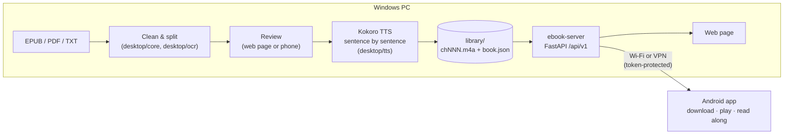

<div align="center">

# Ebook Audio

**Turn your ebooks into audiobooks on your own PC, then listen on any Android phone with the text highlighted as it is read.**

[](https://github.com/Fgkl10/ebook-convert-to-audio/actions/workflows/ci.yml)
[](LICENSE)


**English** · [简体中文](README.zh-CN.md) · [繁體中文](README.zh-TW.md)

</div>

---

## Contents

- [Overview](#overview)
- [Features](#features)
- [How it works](#how-it-works)
- [Requirements](#requirements)
- [Installation (PC)](#installation-pc)
- [Quick start](#quick-start)
- [Command-line usage](#command-line-usage)
- [Configuration](#configuration)
- [Connecting a phone](#connecting-a-phone)
- [Android app](#android-app)
- [Languages](#languages)
- [Troubleshooting](#troubleshooting)
- [Project structure](#project-structure)
- [Development](#development)
- [Roadmap](#roadmap)
- [License](#license)

## Overview

Ebook Audio converts EPUB, PDF and TXT books into audiobooks **locally**. It uses the
[Kokoro-82M](https://huggingface.co/hexgrad/Kokoro-82M) text-to-speech model, so no cloud service and no account
are needed. Each sentence is synthesized separately, so the app knows exactly when each sentence starts and ends. The
Android app uses this to **highlight the sentence being read**, and you can tap any sentence to jump to it.

A small server on the PC holds the library. You control it from a web page or from the phone. The phone downloads
books over Wi-Fi (or a VPN) and plays them offline.

## Features

| | |
|---|---|
| **Local, private TTS** | Kokoro-82M on an NVIDIA GPU (CPU works, slowly). Your books never leave your devices. |
| **Book cleaning with review** | Headers, footers, page numbers, footnote markers and other clutter are removed. The book is split into chapters, and you review the result before converting. |
| **Scanned PDFs** | Optional OCR (docTR) for image-only or garbled PDFs. |
| **Sentence-accurate read-along** | The text follows the audio sentence by sentence, on the phone and in the browser. |
| **Partial conversions** | Convert one chapter to try a voice, add more chapters later, cancel and resume. |
| **Android player** | Offline playback, background and lock-screen controls, a sleep timer (minutes or end of chapter), variable speed, text size. |
| **Works on any Android phone** | Android 8.0 or later. No Google Play services needed. |
| **English and Chinese interface** | The app and the web page are in English, Simplified Chinese and Traditional Chinese. |
| **Open API** | Everything the web page does goes through a documented JSON API (`/api/v1`, OpenAPI at `/docs`). |

> **Note:** the voices currently speak **English** only, so books in other languages are refused. Chinese voices are
> planned (see [Roadmap](#roadmap)).

## How it works



Each converted book is a folder `library/<book_id>/` with one AAC audio file per chapter (`ch000.m4a`, `ch001.m4a`,
…) and a `book.json` manifest. The manifest lists chapters → sentences with `start_ms` / `end_ms`, so the timing
needs no forced alignment.

## Requirements

| Component | Requirement |
|---|---|
| PC operating system | Windows 10/11 (the development and test platform) |
| Python | 3.10, 3.11 or 3.12 |
| ffmpeg | On `PATH` |
| GPU | NVIDIA with CUDA recommended. CPU works but is much slower |
| Disk | About 450 MB for the models (Kokoro ~313 MB, OCR ~120 MB), plus the audiobooks |
| Phone | Any Android phone with Android 8.0 (API 26) or later |
| Building the app (optional; [releases](https://github.com/Fgkl10/ebook-convert-to-audio/releases/latest) have the APK) | JDK 21 (for example Android Studio's bundled `jbr`) and the Android SDK |

## Installation (PC)

```powershell
git clone https://github.com/Fgkl10/ebook-convert-to-audio.git
cd ebook-convert-to-audio

py -3.10 -m venv .venv
.venv\Scripts\pip install torch --index-url https://download.pytorch.org/whl/cu124   # PyTorch with CUDA first
.venv\Scripts\pip install -r requirements.txt
.venv\Scripts\pip install -e .            # installs ebook-server, ebook-normalize and ebook-convert

# Optional: OCR for scanned PDFs (docTR; keeps the CUDA build of PyTorch)
.venv\Scripts\pip install -r requirements-ocr.txt
```

The models download on first use into `models/` inside the project. Set `HF_HOME` / `DOCTR_CACHE_DIR` to keep them
somewhere else.

## Quick start

```powershell
.venv\Scripts\activate
ebook-server
```

Open <http://localhost:8000> and follow the three tabs:

1. **Clean**: upload a book. It is cleaned and split into chapters. Review the report and the chapter text, or tick
   "skip review".
2. **Convert**: choose the voice (▶ plays a sample), the speed and the chapters, then **Approve & convert**. Progress is
   shown live, and you can cancel and resume later.
3. **Library**: play a book in the browser with the sentence highlighting, or open it on your phone.

> **Tip:** to try a voice, convert a single chapter first.

## Command-line usage

You can clean and convert without the server:

```powershell
ebook-normalize path\to\book.epub                   # writes book.std.epub + book.std.report.txt
ebook-convert path\to\book.std.epub --voice af_heart
ebook-convert path\to\book.std.epub --list-chapters # numbered chapter list
ebook-convert path\to\book.std.epub --chapters 1    # one chapter (also 2-4 or 1,3,5-6)
```

| Command | Main options |
|---|---|
| `ebook-server` | `--port` (default 8000), `--advertise ADDRESS`, `--new-token` |
| `ebook-normalize` | `--out`, `--ocr auto\|always\|never`, `--ignore-language` |
| `ebook-convert` | `--voice`, `--speed`, `--chapters`, `--list-chapters`, `--out`, `--ignore-language` |

## Configuration

| Setting | Purpose |
|---|---|
| `EBOOK_AUDIO_DATA=<folder>` | Keep `library/`, `cache/`, `drafts/` and the pairing token outside the project folder |
| `EBOOK_AUDIO_ADVERTISE=<address>` / `--advertise` | The address the pairing QR code shows by default |
| `HF_HOME`, `DOCTR_CACHE_DIR` | Where the TTS and OCR models are stored |
| `ebook-server --new-token` | Make a new pairing token. This unpairs every phone |

The API reference is at <http://localhost:8000/docs> while the server runs. The full route table is in
[`desktop/docs/api.md`](desktop/docs/api.md).

## Connecting a phone

1. Start `ebook-server` and open <http://localhost:8000> on the PC.
2. In the app, scan the QR code on that page. It holds the server's address and an access token. Without the token
   the API answers `401`. The PC's own browser needs no token.
3. **Firewall:** allow inbound TCP on the server's port (8000 by default) for the network the phone uses.

**The phone can't reach the PC?** Some routers isolate Wi-Fi clients ("AP isolation"). In that case, connect both
devices through a VPN such as [ZeroTier](https://www.zerotier.com/). Then open **Other addresses** on the page, pick
the VPN address (or type one and press **Show QR**), and scan again.

## Android app

### Get the APK

Download `ebook-audio-<version>.apk` from the [latest release](https://github.com/Fgkl10/ebook-convert-to-audio/releases/latest).
No build is needed. Every APK is signed with the project's key, so a newer one installs over an older one and keeps
your downloads and settings.

The newest build of `master`, from after the last release, is under
[Actions → APK](https://github.com/Fgkl10/ebook-convert-to-audio/actions/workflows/apk.yml): open the latest run and
download the artifact (a zip with the APK inside; it requires signing in to GitHub).

Or build it yourself:

```powershell
$env:JAVA_HOME = "C:\Program Files\Android\Android Studio\jbr"   # wherever Android Studio is installed
cd android
.\gradlew :app:assembleDebug        # -> app\build\outputs\apk\debug\app-debug.apk
```

A build made without the project's key can't install over a downloaded APK, or the other way round. Android then
asks you to uninstall first, which deletes the app's downloads and settings.

### Install

Install the APK on your phone either way:

- **Copy the APK** to the phone and open it. Allow "Install unknown apps" for the app you opened it with.
- **Over USB with adb:** enable *Developer options* (Settings → About phone → tap **Build number** 7 times), turn on
  **USB debugging**, connect the cable, then:
  ```powershell
  adb install -r app\build\outputs\apk\debug\app-debug.apk
  ```

<details>
<summary>Vendor notes for installing over USB</summary>

| Vendor | Notes |
|---|---|
| Xiaomi / Redmi / POCO (HyperOS, MIUI) | Developer options: tap **OS version** (MIUI: **MIUI version**) 7 times under *About phone* / *All specs*. Also turn on **Install via USB** (needs a Mi account) and tap **Install** on the phone's prompt within 10 seconds |
| OPPO / OnePlus / realme (ColorOS) | Turn off **Permission monitoring** in Developer options if the install is blocked |
| vivo / iQOO (OriginOS) | Turn on **Install via USB** in Developer options |
| Huawei / Honor | Allow **"Allow ADB debugging in charge only mode"** if the phone doesn't show up |

</details>

### Use

- **Library:** books on the PC can be streamed or downloaded. Downloaded books play offline.
- **Convert:** everything the web page does. Add a book (`.epub`, `.pdf`, `.txt`, or an already-cleaned `.std.epub`),
  review the cleaning report and chapters, pick voice, speed and chapters, convert, follow the progress, cancel or
  discard. You can also send books to the app with **Open with** or **Share** from a file manager, chat app or browser.
- **Player:** shows the chapter text with the current sentence highlighted. Tap a sentence to play from it. There are
  previous/next sentence buttons, text size, a cover view and a **sleep timer** (15–60 minutes, any number of
  minutes, or the end of the chapter, with a 10-second fade-out). The screen stays on while the text is shown.

### Background playback

Android, and many vendor skins even more, may stop apps in the background to save battery. If playback stops when the
screen is off, exempt the app from battery optimization. The app's **Settings** screen shows the steps for your phone's
maker and has a button to open the app's system settings.

| Vendor | What to change |
|---|---|
| Xiaomi / Redmi / POCO (HyperOS, MIUI) | Battery saver → **No restrictions**; **Autostart** on; lock the app in Recents |
| Huawei / Honor (HarmonyOS, EMUI, MagicOS) | App launch → turn off *Manage automatically*, allow background activity |
| Samsung (One UI) | Battery → **Unrestricted**; keep the app out of *Sleeping apps* / *Deep sleeping apps* |
| OPPO / OnePlus / realme | Battery usage → allow background activity and auto launch |
| vivo / iQOO | Background power consumption → **Allow**; Autostart on |
| Pixel and stock Android | Battery → **Unrestricted** |

See [dontkillmyapp.com](https://dontkillmyapp.com/) for other devices.

The app uses **no Google services** (QR scanning uses ZXing), so it works on phones without Google Play.

## Languages

| | English | 简体中文 | 繁體中文 |
|---|:---:|:---:|:---:|
| Android app | ✓ | ✓ | ✓ |
| Web page | ✓ | ✓ | ✓ |
| Documentation (README) | ✓ | ✓ | ✓ |
| Speech (voices) | ✓ | planned | planned |

- **Android:** the app follows the phone's language. To use another language, open the app's **Settings →
  Language**. This also works on phones like Xiaomi's that hide the system's per-app language screen. It has been
  tested on Android 14; on Android 8–12 it is untested, and there the download notification may stay in the
  phone's language.
- **Web page:** follows the browser's language. Use the **EN / 简体 / 繁體** buttons at the top to switch. The browser
  remembers the choice.
- Messages that come from the PC (error details, cleaning-report entries) are still in English.

## Troubleshooting

| Problem | What to try |
|---|---|
| The phone says it can't reach the PC | Check the firewall rule for port 8000, check that both devices are on the same network, or use a VPN address (see [Connecting a phone](#connecting-a-phone)) |
| "The PC refused this code" | The token changed (`--new-token`). Scan the QR code again |
| A book is refused as "not English" | Only English voices exist so far. If the book really is English, use `--ignore-language` on the command line |
| Playback stops with the screen off | See [Background playback](#background-playback) |
| A scanned PDF has no text | Install `requirements-ocr.txt` and choose OCR **Always** |
| Conversion is slow | Check that PyTorch sees the GPU: `python -c "import torch; print(torch.cuda.is_available())"` |

## Project structure

| Path | Contents |
|---|---|
| `desktop/core/` | Book text: parsing, chapter splitting, cleaning (no web or GPU code) |
| `desktop/ocr/` | Scanned-PDF OCR (optional, docTR) |
| `desktop/tts/` | Kokoro speech, sentence timing, the converter |
| `desktop/server/` | Backend and the JSON API under `/api/v1` |
| `desktop/web/` | The web page (HTML/JS/CSS) and its translations (`i18n/`) |
| `android/` | Android app (Kotlin, Jetpack Compose, Media3) |
| `tests/` | Python tests (pytest), including the contract tests between server and app |

Each component documents its workflows, architecture, design decisions and test cases:

- Desktop: [`desktop/docs/`](desktop/docs/) ([workflow](desktop/docs/workflow.md) ·
  [architecture](desktop/docs/architecture.md) · [decisions](desktop/docs/decisions.md) ·
  [test cases](desktop/docs/test-cases.md))
- Android: [`android/docs/`](android/docs/) ([workflow](android/docs/workflow.md) ·
  [architecture](android/docs/architecture.md) · [decisions](android/docs/decisions.md) ·
  [test cases](android/docs/test-cases.md))

## Development

```powershell
# Python: tests (no GPU needed; a fake TTS is used)
.venv\Scripts\python -m pytest tests/ -v

# Android: unit tests, lint, debug APK
cd android
.\gradlew :app:testDebugUnitTest :app:lintDebug :app:assembleDebug
```

CI (GitHub Actions) runs both on every pull request. Work happens in one branch and one pull request per milestone.
A change to a flow, a module boundary, a data format or a design choice updates the component docs (`desktop/docs/`,
`android/docs/`) in the same pull request.

**Releasing the app:** each push to `master` that changes `android/` builds a signed APK (workflow `apk.yml`). To
publish a release, tag the commit and push the tag:

```powershell
git tag v0.5.0
git push origin v0.5.0      # -> a GitHub Release with ebook-audio-0.5.0.apk
```

## Roadmap

- [x] M1 TTS proof of concept · M2 converter CLI · M3 server and web UI
- [x] M4a Android player (pairing, downloads, background playback) · M4b manage conversions from the phone
- [x] M5 read-along on the phone, sleep timer, web reader controls
- [x] M6a interface in Simplified and Traditional Chinese; support for all Android phones
- [ ] Chinese voices: convert Chinese books (Simplified and Traditional)
- [ ] Further polish

## License

The source code is released under the [MIT License](LICENSE).

Third-party components keep their own licenses. The Kokoro-82M model is Apache-2.0. Some Python dependencies are
**AGPL-3.0**, notably [PyMuPDF](https://pymupdf.readthedocs.io/) and [EbookLib](https://github.com/aerkalov/ebooklib).
If you redistribute a bundled build, check that those terms fit your use.
