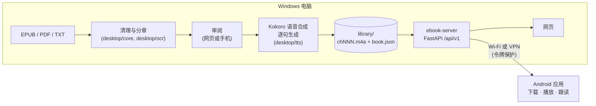

<div align="center">

# 电子书听书（Ebook Audio）

**在自己的电脑上把电子书转换成有声书，然后在任意 Android 手机上收听，朗读到哪一句就高亮哪一句。**

[](https://github.com/Fgkl10/ebook-convert-to-audio/actions/workflows/ci.yml)
[](LICENSE)


[English](README.md) · **简体中文** · [繁體中文](README.zh-TW.md)

</div>

---

## 目录

- [简介](#简介)
- [功能](#功能)
- [工作原理](#工作原理)
- [系统要求](#系统要求)
- [安装（电脑）](#安装电脑)
- [快速上手](#快速上手)
- [命令行用法](#命令行用法)
- [配置](#配置)
- [连接手机](#连接手机)
- [Android 应用](#android-应用)
- [界面语言](#界面语言)
- [常见问题](#常见问题)
- [项目结构](#项目结构)
- [开发](#开发)
- [路线图](#路线图)
- [许可证](#许可证)

## 简介

电子书听书在**本地**把 EPUB、PDF 和 TXT 电子书转换为有声书。它使用
[Kokoro-82M](https://huggingface.co/hexgrad/Kokoro-82M) 语音合成模型，不需要云服务，也不需要注册账号。每个句子单独合成，
所以应用知道每一句的准确起止时间。Android 应用借此**高亮正在朗读的句子**，点按任意句子即可跳转到那里。

电脑上运行一个小型服务器来管理书库，可以通过网页或手机来操作。手机通过 Wi-Fi（或 VPN）下载书籍，下载后可离线播放。

## 功能

| | |
|---|---|
| **本地、私密的语音合成** | 在 NVIDIA 显卡上运行 Kokoro-82M（也可以用 CPU，但较慢）。书籍不会离开你自己的设备。 |
| **清理书籍并审阅** | 自动去除页眉、页脚、页码、脚注标记等杂项，并拆分章节。转换前可以先审阅结果。 |
| **扫描版 PDF** | 可选的 OCR（docTR），用于只有图片或文字层乱码的 PDF。 |
| **逐句精确的跟读** | 文字随音频逐句高亮，手机和浏览器上都可以。 |
| **部分转换** | 先转换一章试听声音，之后再添加更多章节；可以取消并从中断处继续。 |
| **Android 播放器** | 离线播放、后台与锁屏控制、睡眠定时（按分钟或播完本章）、倍速、文字大小。 |
| **支持所有 Android 手机** | Android 8.0 及以上，不需要 Google Play 服务。 |
| **中英文界面** | 应用和网页都提供英文、简体中文和繁体中文。 |
| **开放的 API** | 网页的所有操作都通过有文档的 JSON API 完成（`/api/v1`，OpenAPI 见 `/docs`）。 |

> **注意：** 目前的声音只能朗读**英文**，其他语言的书会被拒绝。中文声音已在计划中（见[路线图](#路线图)）。

## 工作原理



每本转换好的书是一个文件夹 `library/<book_id>/`，每章一个 AAC 音频文件（`ch000.m4a`、`ch001.m4a`……），外加一个
`book.json` 清单。清单列出章节及其句子的 `start_ms` / `end_ms`，所以时间对齐不需要强制对齐（forced alignment）。

## 系统要求

| 组件 | 要求 |
|---|---|
| 电脑操作系统 | Windows 10/11（开发与测试平台） |
| Python | 3.10、3.11 或 3.12 |
| ffmpeg | 已加入 `PATH` |
| 显卡 | 推荐支持 CUDA 的 NVIDIA 显卡；CPU 也能用，但慢很多 |
| 磁盘 | 模型约 450 MB（Kokoro 约 313 MB，OCR 约 120 MB），另加有声书本身 |
| 手机 | 任意 Android 8.0（API 26）及以上的手机 |
| 编译应用 | JDK 21（例如 Android Studio 自带的 `jbr`）和 Android SDK |

## 安装（电脑）

```powershell
git clone https://github.com/Fgkl10/ebook-convert-to-audio.git
cd ebook-convert-to-audio

py -3.10 -m venv .venv
.venv\Scripts\pip install torch --index-url https://download.pytorch.org/whl/cu124   # 先安装带 CUDA 的 PyTorch
.venv\Scripts\pip install -r requirements.txt
.venv\Scripts\pip install -e .            # 安装 ebook-server、ebook-normalize 和 ebook-convert 命令

# 可选：扫描版 PDF 的 OCR（docTR，保留 CUDA 版 PyTorch）
.venv\Scripts\pip install -r requirements-ocr.txt
```

模型会在首次使用时下载到项目内的 `models/` 文件夹。设置 `HF_HOME` / `DOCTR_CACHE_DIR` 可以把它们放到别处。

## 快速上手

```powershell
.venv\Scripts\activate
ebook-server
```

打开 <http://localhost:8000>，依次使用三个标签页：

1. **清理**：上传一本书。它会被清理并拆分章节。你可以审阅报告和各章文字，或者勾选“跳过审阅”。
2. **转换**：选择声音（▶ 可试听）、语速和章节，然后点 **批准并转换**。进度实时显示，可以取消，之后再继续。
3. **书库**：在浏览器中播放并逐句高亮，或者在手机上打开。

> **提示：** 想试听某个声音时，先只转换一章。

## 命令行用法

不启动服务器也可以清理和转换：

```powershell
ebook-normalize path\to\book.epub                   # 生成 book.std.epub 和 book.std.report.txt
ebook-convert path\to\book.std.epub --voice af_heart
ebook-convert path\to\book.std.epub --list-chapters # 列出带编号的章节
ebook-convert path\to\book.std.epub --chapters 1    # 只转换一章（也可以 2-4 或 1,3,5-6）
```

| 命令 | 主要参数 |
|---|---|
| `ebook-server` | `--port`（默认 8000）、`--advertise ADDRESS`、`--new-token` |
| `ebook-normalize` | `--out`、`--ocr auto\|always\|never`、`--ignore-language` |
| `ebook-convert` | `--voice`、`--speed`、`--chapters`、`--list-chapters`、`--out`、`--ignore-language` |

## 配置

| 设置 | 作用 |
|---|---|
| `EBOOK_AUDIO_DATA=<文件夹>` | 把 `library/`、`cache/`、`drafts/` 和配对令牌放在项目文件夹之外 |
| `EBOOK_AUDIO_ADVERTISE=<地址>` / `--advertise` | 配对二维码默认显示的地址 |
| `HF_HOME`、`DOCTR_CACHE_DIR` | 语音和 OCR 模型的存放位置 |
| `ebook-server --new-token` | 生成新的配对令牌，所有手机都会解除配对 |

服务器运行时，API 文档在 <http://localhost:8000/docs>。完整的路由表见
[`desktop/docs/architecture.md`](desktop/docs/architecture.md)。

## 连接手机

1. 启动 `ebook-server`，在电脑上打开 <http://localhost:8000>。
2. 在应用中扫描该页面上的二维码。二维码包含服务器地址和访问令牌；没有令牌时 API 返回 `401`。电脑自己的浏览器不需要令牌。
3. **防火墙：** 为手机所用的网络放行服务器端口（默认 8000）的入站 TCP 连接。

**手机连不上电脑？** 有些路由器会隔离 Wi-Fi 设备（“AP 隔离”）。这时可以用 [ZeroTier](https://www.zerotier.com/)
等 VPN 把两台设备连起来，然后在页面上展开 **其他地址**，选择 VPN 地址（或输入地址后点 **显示二维码**），再扫描一次。

## Android 应用

### 编译

```powershell
$env:JAVA_HOME = "C:\Program Files\Android\Android Studio\jbr"   # Android Studio 的安装位置
cd android
.\gradlew :app:assembleDebug        # -> app\build\outputs\apk\debug\app-debug.apk
```

### 安装

两种方式任选其一：

- **复制 APK** 到手机上并打开。需要允许打开它的那个应用“安装未知应用”。
- **通过 USB 用 adb 安装：** 打开*开发者选项*（设置 → 关于手机 → 连续点按 **版本号** 7 次），开启 **USB 调试**，连接数据线，然后运行：
  ```powershell
  adb install -r app\build\outputs\apk\debug\app-debug.apk
  ```

<details>
<summary>各品牌通过 USB 安装的注意事项</summary>

| 品牌 | 说明 |
|---|---|
| 小米 / Redmi / POCO（HyperOS、MIUI） | 开发者选项：在*我的设备* / *全部参数*中连续点按 **OS 版本**（MIUI 为 **MIUI 版本**）7 次。还要开启 **USB 安装**（需要小米账号），并在 10 秒内点按手机上的 **安装** 提示 |
| OPPO / 一加 / realme（ColorOS） | 如果安装被拦截，在开发者选项中关闭 **权限监控** |
| vivo / iQOO（OriginOS） | 在开发者选项中开启 **USB 安装** |
| 华为 / 荣耀 | 如果电脑识别不到手机，开启 **“仅充电”模式下允许 ADB 调试** |

</details>

### 使用

- **书库：** 电脑上的书可以在线播放或下载，下载的书可离线播放。
- **转换：** 网页能做的事这里都能做。添加书籍（`.epub`、`.pdf`、`.txt`，或已清理的 `.std.epub`），审阅清理报告和章节，
  选择声音、语速和章节，转换，查看进度，取消或丢弃。也可以在文件管理器、聊天应用或浏览器中用 **打开方式** 或 **分享** 把书发送到本应用。
- **播放器：** 显示本章文字并高亮当前句子，点按句子即可从那里播放。提供上一句 / 下一句按钮、文字大小、封面视图，
  以及**睡眠定时**（15–60 分钟、任意分钟数或播完本章，最后 10 秒渐弱）。显示文字时屏幕保持常亮。

### 后台播放

Android 系统，尤其是很多厂商定制系统，会为了省电停止后台应用。如果熄屏后播放停止，请把本应用从电池优化中排除。
应用的**设置**页面会根据手机品牌显示对应步骤，并提供按钮打开本应用的系统设置。

| 品牌 | 需要修改的设置 |
|---|---|
| 小米 / Redmi / POCO（HyperOS、MIUI） | 省电策略 → **无限制**；开启 **自启动**；在最近任务中锁定应用 |
| 华为 / 荣耀（HarmonyOS、EMUI、MagicOS） | 启动管理 → 关闭*自动管理*，允许后台活动 |
| 三星（One UI） | 电池 → **不受限制**；不要把应用加入*休眠应用* / *深度休眠应用* |
| OPPO / 一加 / realme | 耗电管理 → 允许后台行为和自动启动 |
| vivo / iQOO | 后台耗电管理 → **允许**；开启自启动 |
| Pixel 及原生 Android | 电池 → **不受限制** |

其他设备可参考 [dontkillmyapp.com](https://dontkillmyapp.com/)。

本应用**不使用任何 Google 服务**（二维码扫描用的是 ZXing），因此在没有 Google Play 的手机上也能正常使用。

## 界面语言

| | English | 简体中文 | 繁體中文 |
|---|:---:|:---:|:---:|
| Android 应用 | ✓ | ✓ | ✓ |
| 网页 | ✓ | ✓ | ✓ |
| 文档（README） | ✓ | ✓ | ✓ |
| 朗读（声音） | ✓ | 计划中 | 计划中 |

- **Android：** 应用跟随手机的系统语言。在 Android 13 及以上版本，还可以单独为本应用选择语言（设置 → 应用 → 电子书听书 → 语言）。
- **网页：** 跟随浏览器语言，也可以用顶部的 **EN / 简体 / 繁體** 按钮切换，浏览器会记住你的选择。
- 来自电脑的消息（错误详情、清理报告条目）目前仍是英文。

## 常见问题

| 问题 | 解决办法 |
|---|---|
| 手机提示无法连接电脑 | 检查 8000 端口的防火墙规则，确认两台设备在同一网络，或者使用 VPN 地址（见[连接手机](#连接手机)） |
| “电脑拒绝了此配对码” | 令牌已更换（`--new-token`），请重新扫描二维码 |
| 书被判定为“不是英文” | 目前只有英文声音。如果书确实是英文，可在命令行使用 `--ignore-language` |
| 熄屏后播放停止 | 见[后台播放](#后台播放) |
| 扫描版 PDF 没有文字 | 安装 `requirements-ocr.txt`，并把 OCR 设为 **始终** |
| 转换很慢 | 检查 PyTorch 是否识别到显卡：`python -c "import torch; print(torch.cuda.is_available())"` |

## 项目结构

| 路径 | 内容 |
|---|---|
| `desktop/core/` | 书籍文字：解析、分章、清理（不含网页或 GPU 代码） |
| `desktop/ocr/` | 扫描版 PDF 的 OCR（可选，docTR） |
| `desktop/tts/` | Kokoro 语音、句子时间、转换器 |
| `desktop/server/` | 后端和 `/api/v1` 下的 JSON API |
| `desktop/web/` | 网页（HTML/JS/CSS）及其翻译（`i18n/`） |
| `android/` | Android 应用（Kotlin、Jetpack Compose、Media3） |
| `tests/` | Python 测试（pytest），包括服务器与应用之间的契约测试 |

每个组件都有自己的文档，记录工作流程、架构、设计决策和测试用例（英文）：

- 电脑端：[`desktop/docs/`](desktop/docs/)（[工作流程](desktop/docs/workflow.md) ·
  [架构](desktop/docs/architecture.md) · [设计决策](desktop/docs/decisions.md) ·
  [测试用例](desktop/docs/test-cases.md)）
- Android：[`android/docs/`](android/docs/)（[工作流程](android/docs/workflow.md) ·
  [架构](android/docs/architecture.md) · [设计决策](android/docs/decisions.md) ·
  [测试用例](android/docs/test-cases.md)）

## 开发

```powershell
# Python：测试（无需显卡，使用模拟的 TTS）
.venv\Scripts\python -m pytest tests/ -v

# Android：单元测试、lint、调试版 APK
cd android
.\gradlew :app:testDebugUnitTest :app:lintDebug :app:assembleDebug
```

CI（GitHub Actions）会在每个拉取请求上运行这两项。开发流程是每个里程碑一个分支、一个拉取请求，组件文档在同一个拉取请求中更新
（见 [`CLAUDE.md`](CLAUDE.md)）。

## 路线图

- [x] M1 语音合成原型 · M2 转换命令行 · M3 服务器与网页
- [x] M4a Android 播放器（配对、下载、后台播放） · M4b 在手机上管理转换
- [x] M5 手机跟读、睡眠定时、网页阅读器控制
- [x] M6a 简体与繁体中文界面；支持所有 Android 手机
- [ ] 中文声音：转换中文书籍（简体与繁体）
- [ ] 进一步完善

## 许可证

源代码以 [MIT 许可证](LICENSE)发布。

第三方组件遵循各自的许可证。Kokoro-82M 模型为 Apache-2.0。部分 Python 依赖为 **AGPL-3.0**，主要是
[PyMuPDF](https://pymupdf.readthedocs.io/) 和 [EbookLib](https://github.com/aerkalov/ebooklib)。
如果你要分发打包后的版本，请确认这些条款适合你的用途。
