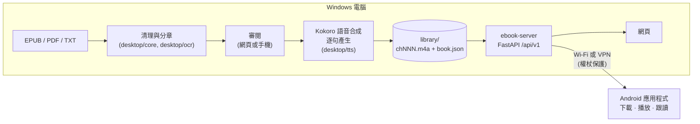

<div align="center">

# 電子書聽書（Ebook Audio）

**在自己的電腦上把電子書轉換成有聲書，然後在任何 Android 手機上收聽，唸到哪一句就標示哪一句。**

[](https://github.com/Fgkl10/ebook-convert-to-audio/actions/workflows/ci.yml)
[](LICENSE)


[English](README.md) · [简体中文](README.zh-CN.md) · **繁體中文**

</div>

---

## 目錄

- [簡介](#簡介)
- [功能](#功能)
- [運作方式](#運作方式)
- [系統需求](#系統需求)
- [安裝（電腦）](#安裝電腦)
- [快速上手](#快速上手)
- [命令列用法](#命令列用法)
- [設定](#設定)
- [連接手機](#連接手機)
- [Android 應用程式](#android-應用程式)
- [介面語言](#介面語言)
- [疑難排解](#疑難排解)
- [專案結構](#專案結構)
- [開發](#開發)
- [發展藍圖](#發展藍圖)
- [授權條款](#授權條款)

## 簡介

電子書聽書在**本機**把 EPUB、PDF 和 TXT 電子書轉換為有聲書。它使用
[Kokoro-82M](https://huggingface.co/hexgrad/Kokoro-82M) 語音合成模型，不需要雲端服務，也不需要註冊帳號。每個句子各自合成，
所以應用程式知道每一句的準確起訖時間。Android 應用程式藉此**標示正在朗讀的句子**，輕觸任何句子即可跳到那裡。

電腦上執行一個小型伺服器來管理書庫，可以透過網頁或手機操作。手機透過 Wi-Fi（或 VPN）下載書籍，下載後即可離線播放。

## 功能

| | |
|---|---|
| **本機、私密的語音合成** | 在 NVIDIA 顯示卡上執行 Kokoro-82M（也可以用 CPU，但較慢）。書籍不會離開你自己的裝置。 |
| **清理書籍並審閱** | 自動移除頁首、頁尾、頁碼、註腳標記等雜項，並分割章節。轉換前可以先審閱結果。 |
| **掃描版 PDF** | 可選用的 OCR（docTR），用於只有圖片或文字層亂碼的 PDF。 |
| **逐句精確的跟讀** | 文字隨音訊逐句標示，手機和瀏覽器上都可以。 |
| **部分轉換** | 先轉換一章試聽語音，之後再加入更多章節；可以取消並從中斷處繼續。 |
| **Android 播放器** | 離線播放、背景與鎖定畫面控制、睡眠定時（依分鐘或播完本章）、播放速度、文字大小。 |
| **支援所有 Android 手機** | Android 8.0 以上，不需要 Google Play 服務。 |
| **中英文書籍** | 英文書由英文語音朗讀，中文書（簡體或繁體）由華語語音朗讀，語言從內文自動辨識。可選：約 100 個更好的華語語音（Kokoro v1.1-zh）。 |
| **中英文介面** | 應用程式和網頁都提供英文、簡體中文和繁體中文。 |
| **開放的 API** | 網頁的所有操作都透過有文件的 JSON API 完成（`/api/v1`，OpenAPI 請見 `/docs`）。 |

> **注意：** 其他語言的書會被拒絕。暫不支援**中文**掃描版 PDF：OCR 只能辨識拉丁字母。

## 運作方式



每本轉換好的書是一個資料夾 `library/<book_id>/`，每章一個 AAC 音訊檔（`ch000.m4a`、`ch001.m4a`……），另有一個
`book.json` 清單。清單列出章節及其句子的 `start_ms` / `end_ms`，所以時間對齊不需要強制對齊（forced alignment）。

## 系統需求

| 元件 | 需求 |
|---|---|
| 電腦作業系統 | Windows 10/11（開發與測試平台） |
| Python | 3.10、3.11 或 3.12 |
| ffmpeg | 已加入 `PATH` |
| 顯示卡 | 建議使用支援 CUDA 的 NVIDIA 顯示卡；CPU 也能用，但慢很多 |
| 磁碟 | 模型約 450 MB（Kokoro 約 313 MB，OCR 約 120 MB），可選的中文語音另需約 330 MB，另加有聲書本身 |
| 手機 | 任何 Android 8.0（API 26）以上的手機 |
| 編譯應用程式（選用；[發布頁面](https://github.com/Fgkl10/ebook-convert-to-audio/releases/latest)提供 APK） | JDK 21（例如 Android Studio 內建的 `jbr`）和 Android SDK |

## 安裝（電腦）

```powershell
git clone https://github.com/Fgkl10/ebook-convert-to-audio.git
cd ebook-convert-to-audio

py -3.10 -m venv .venv
.venv\Scripts\pip install torch --index-url https://download.pytorch.org/whl/cu124   # 先安裝支援 CUDA 的 PyTorch
.venv\Scripts\pip install -r requirements.txt
.venv\Scripts\pip install -e .            # 安裝 ebook-server、ebook-normalize 和 ebook-convert 指令

# 選用：掃描版 PDF 的 OCR（docTR，保留 CUDA 版 PyTorch）
.venv\Scripts\pip install -r requirements-ocr.txt
```

模型會在第一次使用時下載到專案內的 `models/` 資料夾。設定 `HF_HOME` / `DOCTR_CACHE_DIR` 可以把它們放到其他位置。

**更好的中文語音（可選）。** 中文書不需額外安裝，使用 Kokoro 內建的 8 個華語語音即可朗讀。想要明顯更好的語音，請開啟網頁，展開頂端的 **更好的中文語音（Kokoro v1.1-zh）**，按 **安裝**（下載約 330 MB，也會多占用一些顯示記憶體）。之後中文語音清單會顯示它的 100 個語音。按 **移除** 可以再刪除。

## 快速上手

```powershell
.venv\Scripts\activate
ebook-server
```

開啟 <http://localhost:8000>，依序使用三個分頁：

1. **清理**：上傳一本書。它會被清理並分割章節。你可以審閱報告和各章文字，或勾選「略過審閱」。
2. **轉換**：選擇語言和語音（▶ 可試聽）、速度和章節，然後按 **核准並轉換**。審閱頁會預設選取書本身的語言。進度即時顯示，可以取消，之後再繼續。
3. **書庫**：在瀏覽器中播放並逐句標示，或在手機上開啟。

> **提示：** 想試聽某個語音時，先只轉換一章。

## 命令列用法

不啟動伺服器也可以清理和轉換：

```powershell
ebook-normalize path\to\book.epub                   # 產生 book.std.epub 和 book.std.report.txt
ebook-convert path\to\book.std.epub --voice af_heart   # 中文書：例如 --voice zf_xiaoxiao
ebook-convert path\to\book.std.epub --list-chapters # 列出編號的章節
ebook-convert path\to\book.std.epub --chapters 1    # 只轉換一章（也可以 2-4 或 1,3,5-6）
```

| 指令 | 主要參數 |
|---|---|
| `ebook-server` | `--port`（預設 8000）、`--advertise ADDRESS`、`--new-token` |
| `ebook-normalize` | `--out`、`--ocr auto\|always\|never`、`--ignore-language` |
| `ebook-convert` | `--voice`、`--speed`、`--chapters`、`--list-chapters`、`--out`、`--ignore-language` |

## 設定

| 設定 | 用途 |
|---|---|
| `EBOOK_AUDIO_DATA=<資料夾>` | 把 `library/`、`cache/`、`drafts/` 和配對權杖放在專案資料夾之外 |
| `EBOOK_AUDIO_ADVERTISE=<位址>` / `--advertise` | 配對 QR 碼預設顯示的位址 |
| `HF_HOME`、`DOCTR_CACHE_DIR` | 語音和 OCR 模型的存放位置 |
| `ebook-server --new-token` | 產生新的配對權杖，所有手機都會解除配對 |

伺服器執行時，API 文件在 <http://localhost:8000/docs>。完整的路由表請見
[`desktop/docs/api.md`](desktop/docs/api.md)。

## 連接手機

1. 啟動 `ebook-server`，在電腦上開啟 <http://localhost:8000>。
2. 在應用程式中掃描該頁面上的 QR 碼。QR 碼包含伺服器位址和存取權杖；沒有權杖時 API 會回傳 `401`。電腦本身的瀏覽器不需要權杖。
3. **防火牆：** 為手機使用的網路開放伺服器連接埠（預設 8000）的輸入 TCP 連線。

**手機連不到電腦？** 有些路由器會隔離 Wi-Fi 裝置（「AP 隔離」）。這時可以用 [ZeroTier](https://www.zerotier.com/)
等 VPN 把兩部裝置連起來，然後在頁面上展開 **其他位址**，選擇 VPN 位址（或輸入位址後按 **顯示 QR 碼**），再掃描一次。

## Android 應用程式

### 取得 APK

從[最新版本](https://github.com/Fgkl10/ebook-convert-to-audio/releases/latest)下載 `ebook-audio-<版本>.apk`，不需要自己編譯。
所有 APK 都以本專案的金鑰簽署，所以新版本可以直接覆蓋安裝舊版本，下載的書和設定都會保留。

上次發布之後 `master` 的最新建置在
[Actions → APK](https://github.com/Fgkl10/ebook-convert-to-audio/actions/workflows/apk.yml)：開啟最近一次執行，下載其中的建置成品（一個內含 APK 的 zip，需要登入 GitHub）。

也可以自己編譯：

```powershell
$env:JAVA_HOME = "C:\Program Files\Android\Android Studio\jbr"   # Android Studio 的安裝位置
cd android
.\gradlew :app:assembleDebug        # -> app\build\outputs\apk\debug\app-debug.apk
```

沒有使用本專案金鑰編譯的 APK 不能覆蓋安裝下載的 APK，反之亦然。這時 Android 會要求先解除安裝，應用程式內下載的書和設定都會被刪除。

### 安裝

兩種方式擇一即可：

- **複製 APK** 到手機上並開啟。需要允許開啟它的那個應用程式「安裝不明應用程式」。
- **透過 USB 用 adb 安裝：** 開啟*開發人員選項*（設定 → 關於手機 → 連續輕觸 **版本號碼** 7 次），開啟 **USB 偵錯**，接上傳輸線，然後執行：
  ```powershell
  adb install -r app\build\outputs\apk\debug\app-debug.apk
  ```

<details>
<summary>各品牌透過 USB 安裝的注意事項</summary>

| 品牌 | 說明 |
|---|---|
| 小米 / Redmi / POCO（HyperOS、MIUI） | 開發人員選項：在*我的裝置* / *所有規格*中連續輕觸 **OS 版本**（MIUI 為 **MIUI 版本**）7 次。還要開啟 **透過 USB 安裝**（需要小米帳號），並在 10 秒內輕觸手機上的 **安裝** 提示 |
| OPPO / OnePlus / realme（ColorOS） | 如果安裝被阻擋，在開發人員選項中關閉 **權限監控** |
| vivo / iQOO（OriginOS、Funtouch OS） | 在開發人員選項中開啟 **USB 安裝** |
| 華為 / 榮耀 | 如果電腦偵測不到手機，開啟 **「僅充電」模式下允許 ADB 偵錯** |

</details>

### 使用

- **書庫：** 電腦上的書可以串流播放或下載，下載的書可離線播放。
- **轉換：** 網頁能做的事這裡都能做。新增書籍（`.epub`、`.pdf`、`.txt`，或已清理的 `.std.epub`），審閱清理報告和章節，
  選擇語音、速度和章節，轉換，查看進度，取消或捨棄。也可以在檔案管理員、通訊軟體或瀏覽器中用 **開啟方式** 或 **分享** 把書傳送到本應用程式。
- **播放器：** 顯示本章文字並標示目前的句子，輕觸句子即可從那裡播放。提供上一句 / 下一句按鈕、文字大小、封面檢視，
  以及**睡眠定時**（15–60 分鐘、任意分鐘數或播完本章，最後 10 秒漸弱）。顯示文字時螢幕保持開啟。

### 背景播放

Android 系統，尤其是許多廠商的客製化系統，會為了省電停止背景應用程式。如果關閉螢幕後播放停止，請把本應用程式從電池最佳化中排除。
應用程式的**設定**畫面會依手機品牌顯示對應步驟，並提供按鈕開啟本應用程式的系統設定。

| 品牌 | 需要修改的設定 |
|---|---|
| 小米 / Redmi / POCO（HyperOS、MIUI） | 省電策略 → **無限制**；開啟 **自動啟動**；在最近使用的應用程式中鎖定 |
| 華為 / 榮耀（HarmonyOS、EMUI、MagicOS） | 應用程式啟動管理 → 關閉*自動管理*，允許背景活動 |
| 三星（One UI） | 電池 → **不受限制**；不要把應用程式加入*休眠中的應用程式* / *深度休眠中的應用程式* |
| OPPO / OnePlus / realme | 耗電管理 → 允許背景活動與自動啟動 |
| vivo / iQOO | 背景耗電管理 → **允許**；開啟自動啟動 |
| Pixel 及原生 Android | 電池 → **不受限制** |

其他裝置可參考 [dontkillmyapp.com](https://dontkillmyapp.com/)。

本應用程式**不使用任何 Google 服務**（QR 碼掃描使用 ZXing），因此在沒有 Google Play 的手機上也能正常使用。

## 介面語言

| | English | 简体中文 | 繁體中文 |
|---|:---:|:---:|:---:|
| Android 應用程式 | ✓ | ✓ | ✓ |
| 網頁 | ✓ | ✓ | ✓ |
| 文件（README） | ✓ | ✓ | ✓ |
| 朗讀（語音） | ✓ | ✓（華語） | ✓（華語） |

- **Android：** 應用程式跟隨手機的系統語言。想換成其他語言，請在應用程式內開啟 **設定 → 語言**。小米等隱藏了系統「應用程式語言」頁面的手機也可以使用。此功能已在 Android 14 上測試；Android 8–12 尚未測試，在這些版本上下載通知可能仍顯示手機的系統語言。
- **網頁：** 跟隨瀏覽器語言，也可以用頂端的語言下拉選單（English / 简体中文 / 繁體中文）切換，瀏覽器會記住你的選擇。
- **書籍：** 支援英文和中文，從內文辨識。繁體中文書以華語朗讀，螢幕上的文字仍是繁體。如果所選語音不會說這本書的語言，會換成該語言的預設語音。
- 來自電腦的訊息（錯誤詳情、清理報告項目）目前仍是英文。

## 疑難排解

| 問題 | 解決方法 |
|---|---|
| 手機顯示無法連線到電腦 | 檢查 8000 連接埠的防火牆規則，確認兩部裝置在同一個網路，或使用 VPN 位址（請見[連接手機](#連接手機)） |
| 「電腦拒絕了這個配對碼」 | 權杖已更換（`--new-token`），請重新掃描 QR 碼 |
| 書被判定為「不是英文或中文」 | 目前只有英文和中文語音。如果書確實是其中一種語言，可在命令列使用 `--ignore-language` |
| 關閉螢幕後播放停止 | 請見[背景播放](#背景播放) |
| 掃描版 PDF 沒有文字 | 安裝 `requirements-ocr.txt`，並把 OCR 設為 **一律** |
| 轉換很慢 | 檢查 PyTorch 是否偵測到顯示卡：`python -c "import torch; print(torch.cuda.is_available())"` |

## 專案結構

| 路徑 | 內容 |
|---|---|
| `desktop/core/` | 書籍文字：解析、分章、清理（不含網頁或 GPU 程式碼） |
| `desktop/ocr/` | 掃描版 PDF 的 OCR（選用，docTR） |
| `desktop/tts/` | Kokoro 語音、句子時間、轉換器 |
| `desktop/server/` | 後端和 `/api/v1` 下的 JSON API |
| `desktop/web/` | 網頁（HTML/JS/CSS）及其翻譯（`i18n/`） |
| `android/` | Android 應用程式（Kotlin、Jetpack Compose、Media3） |
| `tests/` | Python 測試（pytest），包含伺服器與應用程式之間的契約測試 |

每個元件都有自己的文件，記錄工作流程、架構、設計決策和測試案例（英文）：

- 電腦端：[`desktop/docs/`](desktop/docs/)（[工作流程](desktop/docs/workflow.md) ·
  [架構](desktop/docs/architecture.md) · [設計決策](desktop/docs/decisions.md) ·
  [測試案例](desktop/docs/test-cases.md)）
- Android：[`android/docs/`](android/docs/)（[工作流程](android/docs/workflow.md) ·
  [架構](android/docs/architecture.md) · [設計決策](android/docs/decisions.md) ·
  [測試案例](android/docs/test-cases.md)）

## 開發

```powershell
# Python：測試（不需要顯示卡，使用模擬的 TTS）
.venv\Scripts\python -m pytest tests/ -v

# Android：單元測試、lint、偵錯版 APK
cd android
.\gradlew :app:testDebugUnitTest :app:lintDebug :app:assembleDebug
```

CI（GitHub Actions）會在每個 Pull Request 上執行這兩項。開發流程是每個里程碑一個分支、一個 Pull Request。
凡是改變流程、模組邊界、資料格式或設計決策的修改，都會在同一個 Pull Request 中更新元件文件（`desktop/docs/`、`android/docs/`）。

**發布應用程式：** 每次推送到 `master` 且修改了 `android/` 時，都會建置一個已簽署的 APK（工作流程 `apk.yml`）。要發布正式版本，替提交加上標籤並推送：

```powershell
git tag v0.5.0
git push origin v0.5.0      # -> 產生附有 ebook-audio-0.5.0.apk 的 GitHub Release
```

## 發展藍圖

- [x] M1 語音合成原型 · M2 轉換命令列 · M3 伺服器與網頁
- [x] M4a Android 播放器（配對、下載、背景播放） · M4b 在手機上管理轉換
- [x] M5 手機跟讀、睡眠定時、網頁閱讀器控制
- [x] M6a 簡體與繁體中文介面；支援所有 Android 手機
- [x] M7 中文語音：轉換中文書籍（簡體與繁體），可選 Kokoro v1.1-zh 語音
- [ ] 中文掃描版 PDF（中文 OCR）
- [ ] 進一步改善

## 授權條款

原始碼以 [MIT 授權條款](LICENSE)釋出。

第三方元件遵循各自的授權條款。Kokoro-82M 和 Kokoro-82M-v1.1-zh 模型為 Apache-2.0。部分 Python 相依套件為 **AGPL-3.0**，主要是
[PyMuPDF](https://pymupdf.readthedocs.io/) 和 [EbookLib](https://github.com/aerkalov/ebooklib)。
如果你要散布打包後的版本，請確認這些條款符合你的用途。
