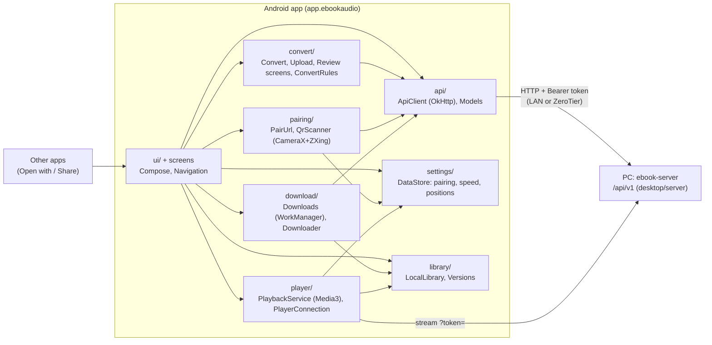

# Android component: architecture

The Android app plays the books converted on the PC: it pairs with the PC server, lists the PC's library, downloads
books into app-private storage, and plays them in the background with notification and lock-screen controls (M4a).
It also manages conversions on the PC like the web page does: upload a book (or an already-cleaned .std.epub),
review the cleaning report and chapters, pick voice, speed and chapters, approve, follow progress, cancel, discard,
and delete books on the PC (M4b). Only the Sigil round trip (download/replace the std.epub) stays on the PC.

## Overview



## Modules (packages of `:app`)

| Package | Files | Responsibility |
|---|---|---|
| (root) | `EbookAudioApp.kt` | `AppGraph`: one OkHttp client, `Settings`, `LocalLibrary`, an app scope; `api()` builds an `ApiClient` from the saved pairing (A-003) |
| `api` | `ApiClient.kt`, `Models.kt` | Typed calls `info`, `books`, `book(id)`; `fileUrl` with `?token=` for the player and Coil. 401 → `NotPaired`; other errors → `ApiError` with the server's `detail`. Models ignore unknown keys |
| `pairing` | `PairUrl.kt`, `Scanner.kt`, `PairScreen.kt` | Parse `http(s)://host:port/#token=…` (D-037); scan with CameraX + ZXing (A-008) or paste; check `GET /info` (`api_version` 1) before saving |
| `settings` | `Settings.kt` | DataStore: pairing `{baseUrl, token, pcName}`, playback speed, last book, position per book (`chapter:ms`), read-along text size and text/cover choice |
| `library` | `LocalLibrary.kt`, `Versions.kt`, `LibraryScreen.kt`, `BookScreen.kt` | Books on the phone (A-004); chapter states and merging (A-009); the On this phone / On the PC tabs; the book screen (play/continue, download, delete, per-chapter state) |
| `download` | `Downloader.kt`, `DownloadWorker.kt` | Range-resumable, size-checked, atomic chapter downloads in a WorkManager foreground worker (A-006) |
| `player` | `PlaybackService.kt`, `PlayerConnection.kt`, `NowPlaying.kt`, `PlayerScreen.kt`, `ReadAlong.kt`, `SentenceSync.kt`, `SleepTimer.kt` | Media3 session + ExoPlayer (A-007); playlist = chapters (file or stream); position saving; the sleep timer and its `app.ebookaudio.SLEEP` session command (A-016); player screen with the read-along text or cover, sentence buttons, text size, keep-screen-on (A-015); mini player |
| `convert` | `ConvertRules.kt`, `ConvertText.kt`, `ConvertScreen.kt`, `UploadScreen.kt`, `ReviewScreen.kt`, `VoicePicker.kt` | The web page's conversion features (A-011): drafts and jobs lists polled every 2 s; upload with voice/speed/skip review/OCR or as a cleaned book (streamed, A-012); review with report, chapter text, chapter picks and the mixed-voice warning; voice samples in a separate short-lived player. `ConvertRules` returns values (`StatusLabel`, `ApproveLabel`, `MixedVoice`); `ConvertText` turns them into localized text (A-017) |
| `ui` | `MainActivity.kt`, `SettingsScreen.kt`, `Theme.kt` (with `Format`), `Texts.kt`, `BackgroundTips.kt`, `AppLanguage.kt` | Edge-to-edge `AppCompatActivity`, the Settings language choice (A-019), navigation with the Library / Convert bottom bar, "Open with"/Share intake (A-013), theme, settings with background-playback steps for the phone's maker (A-018). `Texts.kt`: localized durations and error text (`durationText`, `Resources.errorText`) |

## Text and languages (A-017)

Every user-visible string is a resource: `res/values/strings.xml` (English, the default), `res/values-b+zh+Hans/`
(Simplified Chinese) and `res/values-b+zh+Hant/` (Traditional Chinese, Taiwan wording). Counts use `<plurals>`.
Composables read them with `stringResource` / `pluralStringResource`; code outside composition inside a screen uses
`LocalResources.current` (lint `LocalContextGetResourceValueCall`); the download worker uses its context.
Settings → Language sets the app's language with `AppCompatDelegate.setApplicationLocales` (A-019): on Android 13+
that is the system's per-app language; on 8–12 AppCompat stores it (`AppLocalesMetadataHolderService`,
`autoStoreLocales`) and applies it to the activity. `generateLocaleConfig` lists the three languages for the
system's per-app language setting on Android 13+
(`res/resources.properties`: default `en-US`). Lint's `MissingTranslation` / `ExtraTranslation` fail the build when the
files drift apart.

Not translated: text from the PC (error `detail`s, draft and job messages, cleaning-report entries, chapter titles),
OkHttp's network error messages, and the media notification (Media3's own strings, which Media3 localizes).

## Data on the phone

```
filesDir/books/<book id>/          book id: [a-z0-9-]{1,80}
  book.json                        the phone's manifest: the PC's Book JSON, only the downloaded chapters
  ch000.m4a, ch001.m4a, …          chapter audio (AAC/M4A, as on the PC)
  ch000.m4a.part                   an unfinished download (never played, resumed with Range)
  cover.jpg|png                    optional
DataStore "settings"               pairing, speed, last book, positions
```

`book.json` uses the server's format (`desktop/docs/architecture.md`, `/api/v1/books/{id}`), so the same model
decodes both. Each chapter keeps `size_bytes` and `updated_ms` from the download, which is how "update available"
is detected (D-038, A-009). Its sentences feed the read-along view (A-015); a streamed book's come from
`GET /books/{id}`.

DataStore also keeps the read-along text size (`text_size`, sp) and the text/cover choice (`show_text`).

Sleep timer session interface (A-016): command `app.ebookaudio.SLEEP` with `sleep_mode` = `off` | `minutes` |
`chapter` and `sleep_minutes` (1–1440); session extras `sleep_mode` and `sleep_left_ms` (real time left, whole
seconds; absent when off). Only the app's own controller is offered the command.

## API used (`/api/v1`, see `desktop/docs/architecture.md`)

| Call | Used for |
|---|---|
| `GET /info` | Pairing check (`api_version`, PC name) |
| `GET /books` | The On the PC tab |
| `GET /books/{id}` | Book screen, downloads, version check |
| `GET /books/{id}/files/{name}` | Audio and covers: download (with `Range`) and streaming |
| `DELETE /books/{id}` | Delete from PC (A-014; 409 while converting) |
| `GET /drafts`, `GET /jobs` | The Convert tab (polled every 2 s while visible) |
| `POST /drafts` (multipart: file, voice, speed, auto, ocr) | Upload a book to clean |
| `POST /drafts/cleaned` (multipart: file, voice, speed) | Upload an already-cleaned .std.epub; converts at once |
| `GET /drafts/{id}`, `GET /drafts/{id}/chapters/{i}` | Review: report, picks, chapter text |
| `POST /drafts/{id}/approve` (`{voice, speed, chapters}`; `null` = all) | Convert |
| `POST /drafts/{id}/cancel`, `POST /jobs/{id}/cancel`, `DELETE /drafts/{id}` | Cancel, discard |
| `GET /voices/{voice}/sample` | ▶ voice sample (token in the query) |

Every request sends `Authorization: Bearer <token>`; media URLs carry `?token=` because ExoPlayer and Coil fetch
them themselves.

## Build

| Item | Value |
|---|---|
| Versions | `android/gradle/libs.versions.toml` (A-002) |
| SDK | compileSdk 37.2, targetSdk 37, minSdk 26 (Android 8.0, any vendor) |
| Languages | English (default), `b+zh+Hans`, `b+zh+Hant`; `generateLocaleConfig` (A-017) |
| JDK | 21 (Android Studio's `jbr` locally; Temurin 21 in CI); Java 17 bytecode |
| Commands | `cd android; .\gradlew :app:testDebugUnitTest :app:lintDebug :app:assembleDebug` |
| Output | `android/app/build/outputs/apk/debug/app-debug.apk` (`assembleRelease` → `…/release/app-release.apk`) |
| Version | `versionCode` = `git rev-list --count HEAD` (1 outside git); `versionName` = env `VERSION_NAME` (from the tag on GitHub) else the value in `build.gradle.kts` (A-020) |
| Signing | One release key (A-020), for both debug and release builds when present: env `ANDROID_KEYSTORE_PATH` / `ANDROID_KEYSTORE_PASSWORD` / `ANDROID_KEY_ALIAS` / `ANDROID_KEY_PASSWORD` (GitHub Actions, from the secrets of the same names, the keystore as `ANDROID_KEYSTORE_BASE64`), else the git-ignored `android/keystore/release.properties` + `release.jks`. Without either: the standard debug key |
| CI | the `android` job in `.github/workflows/ci.yml` (every PR and push: tests, lint, a debug APK with the runner's own debug key, not kept) |
| Published APK | `.github/workflows/apk.yml`: a push to `master` touching `android/**` → signed release APK `ebook-audio-<count>-<sha>.apk` as the run's artifact (90 days); a `v*` tag (`create` event) → `ebook-audio-<version>.apk` artifact + GitHub Release. Fails if the key secret is missing; checks the certificate (`CN=Ebook Audio`) with `apksigner` |
