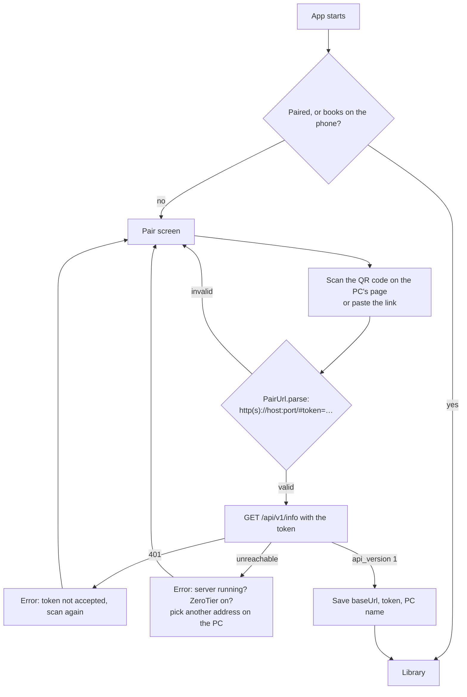
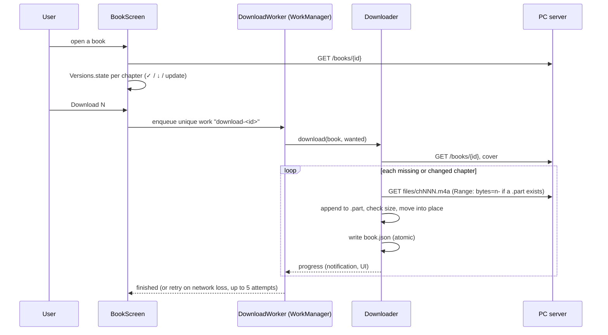
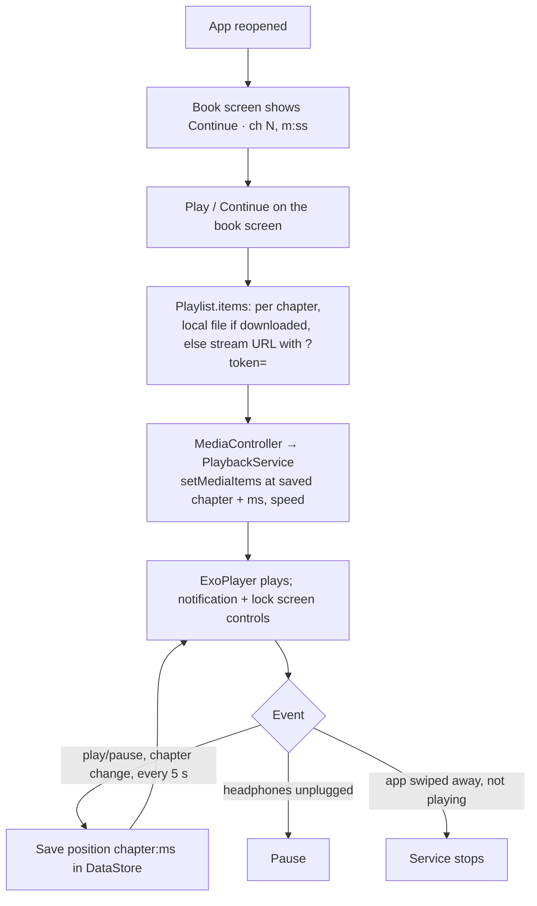
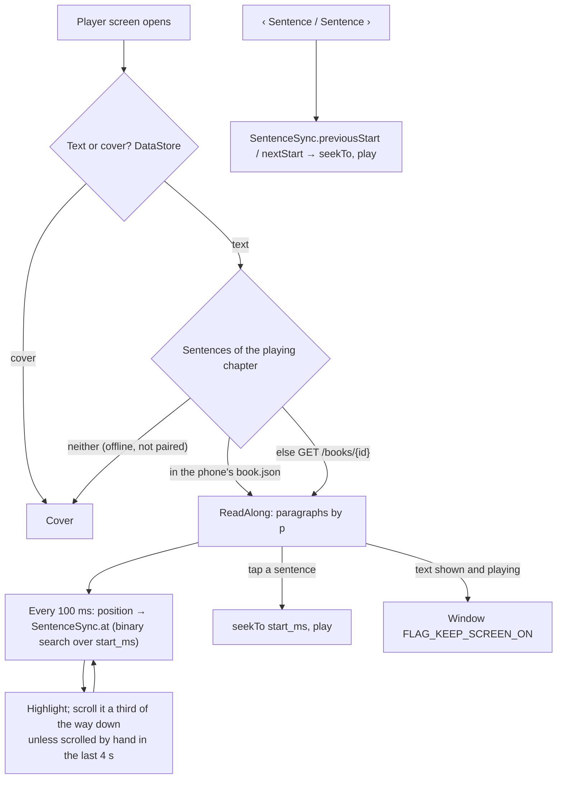
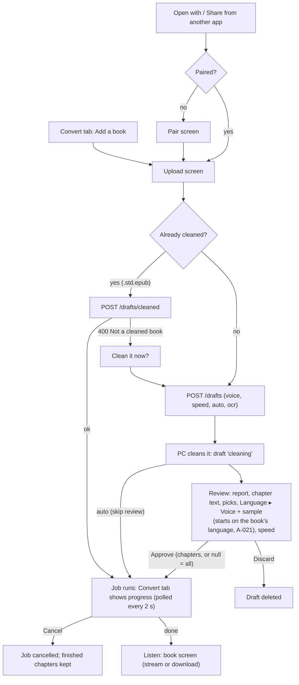
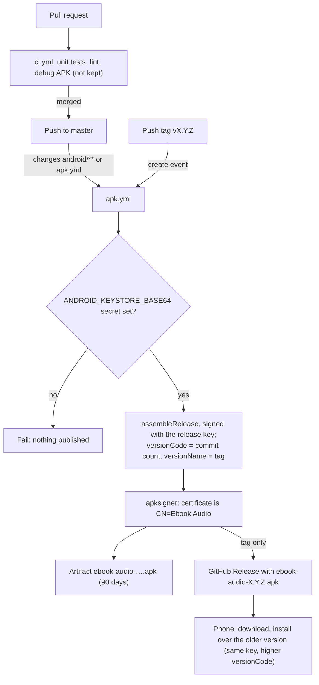

# Android component: workflows

## Start and pairing



## Library and download



## Playback and resume



## Read along (M5)



## Sleep timer (M5)

```mermaid
sequenceDiagram
  participant UI as Player screen
  participant S as PlaybackService
  participant P as ExoPlayer
  UI->>S: custom command SLEEP (minutes N / chapter / off)
  alt minutes
    loop every 250 ms
      S->>S: count down by real time spent playing
      S->>P: volume fades over the last 10 s
      S-->>UI: session extras (mode, time left in whole seconds)
    end
    S->>P: pause at 0; volume 1; timer off
  else end of chapter
    S->>P: pauseAtEndOfMediaItems = true
    P-->>S: paused at the end of the item, or the book ended
    S->>P: pauseAtEndOfMediaItems = false; timer off
  end
```

## Convert on the PC from the phone (M4b)



## Building and publishing the APK (A-020)


