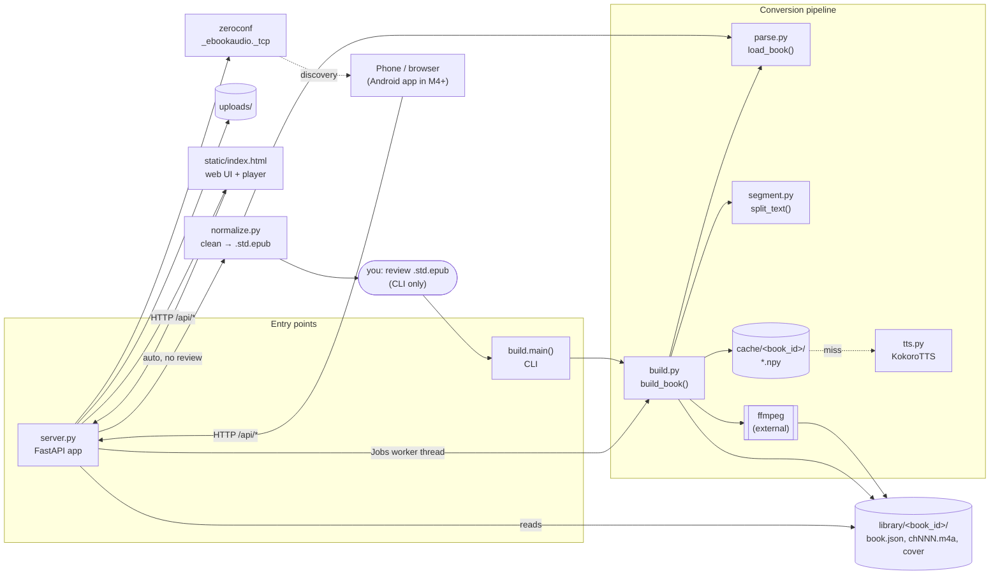

# Desktop component: architecture

The desktop component converts an ebook into a sentence-timestamped audiobook and serves the
library over the LAN. It is a Python package (`desktop/`) with three entry points:

- `python -m desktop.normalize <file>`: cleans any EPUB/PDF/TXT into `<name>.std.epub` plus
  `<name>.std.report.txt` for manual review (D-019). `--ignore-language` skips the English check
- `python -m desktop.build <file.std.epub>`: command-line converter. It only converts cleaned files and
  refuses anything else with the normalize command to run. `--list-chapters` prints numbered chapters, and
  `--ignore-language` skips the English check (D-018).
  `--chapters 3` / `2-4` / `1,3,5-6` converts only those (1-based, after front matter is skipped) into
  `library/<book_id>-ch<spec>/`, a separate folder, so test conversions never touch the full book
- `python -m desktop.server [--port 8000]`: FastAPI server + web UI

## Module diagram



## Modules

| Module | Responsibility | Key API |
|---|---|---|
| `parse.py` | Read EPUB / PDF / TXT (`.md` too) into a uniform `Book` of `Chapter`s. Chapter text is one paragraph per line. Drops chapters under 40 chars. Skips EPUB front matter (cover, title, half title, copyright, contents) using the book's labels, its OPF guide, or exact titles. Extracts the cover. | `load_book(path) -> Book` |
| `segment.py` | Split chapter text into paragraphs of sentences (pysbd). Splits sentences over 350 chars at soft breaks. Attaches punctuation-only fragments to the previous sentence. | `split_text(text) -> list[list[str]]` |
| `normalize.py` | Cleans a book into a standard EPUB: one XHTML file per chapter, with title, author, language, cover and the markers `ebook-audio:normalized` + `ebook-audio:source-sha1`. For EPUB it confirms TOC / contents-page entries against headings in the text and cuts there, dropping front matter, contents pages, bibliography and index. PDF/TXT are repackaged as parsed. It writes a report of chapters, removed text and ignored TOC entries. | `normalize(source, out, ignore_language) -> (path, Report)` |
| `language.py` | Refuses books whose text isn't in a language the voices speak (English today), judged from the share of English function words in text sampled across the book. Metadata is only a hint. Called by `build_book` before TTS loads. | `check_language(book)`, `english_score(book)` |
| `tts.py` | Wrapper around Kokoro-82M. One call per sentence, mono float32 at 24 kHz. Uses CUDA when available. | `KokoroTTS(voice, speed).synth(text)`, `VOICES`, `SAMPLE_RATE` |
| `build.py` | Orchestrates the pipeline: plan, synthesize (cached), stitch with silence gaps, compute timestamps, encode m4a with ffmpeg, write `book.json` after each chapter. | `build_book(source, out_root, voice, speed, progress, tts) -> Path` |
| `server.py` | REST API, single-worker conversion queue, static web UI, mDNS advertisement, QR code for the LAN URL. | FastAPI `app`, `Jobs`, `advertise()` |
| `static/index.html` | Single-page UI: upload/convert, job progress, library grid, reader with sentence highlighting and tap-to-seek. | served at `/` |

## On-disk layout

```
<name>.std.epub            cleaned book next to its source (e.g. samples/), plus <name>.std.report.txt
library/<book_id>/          book_id = <title-slug, max 40 chars>-<sha1(original file)[:8]>;
                            a .std.epub carries the original's sha1, so cleaning or editing keeps the id
    book.json               manifest (below)
    ch000.m4a, ch001.m4a…   AAC 64 kbps mono 24 kHz, +faststart
    cover.<ext>             optional
cache/<book_id>/<sha1>.npy  per-sentence audio, key = sha1("voice|speed|text"); deleted when the book completes
uploads/<rand>_<name>       files uploaded through the server (never cleaned up), plus their .std.epub
```

## `book.json` manifest

```json
{
  "id": "my-book-1a2b3c4d",
  "title": "My Book",
  "author": "Someone",
  "cover": "cover.jpg",
  "voice": "af_heart",
  "speed": 1.0,
  "complete": true,
  "chapter_selection": null,
  "created": 1764230400,
  "duration_ms": 123456,
  "chapters": [
    {
      "index": 0,
      "title": "Chapter 1",
      "audio": "ch000.m4a",
      "duration_ms": 61728,
      "sentences": [
        { "i": 0, "p": 0, "text": "It was a dark night.", "start_ms": 300, "end_ms": 1850 }
      ]
    }
  ]
}
```

Invariants:
- `sentences[k].end_ms == sentences[k+1].start_ms`. The pause after a sentence belongs to that
  sentence, so every playback position maps to exactly one sentence.
- Last sentence `end_ms == chapter.duration_ms`. First `start_ms == 300` (chapter lead-in).
- `p` is the paragraph index within the chapter, and `i` is the sentence index within the chapter.
- `chapter_selection` is `null` for a full book, or the `--chapters` spec (e.g. `"2-4"`) for a partial one.
- `complete: false` means the book is still converting (or was interrupted), but the chapters listed so far are playable.

## HTTP API

| Method & path | Purpose |
|---|---|
| `GET /` | Web UI |
| `GET /api/info` | Host name, LAN URL, QR SVG, voice list, default voice |
| `GET /api/books` | Library summary (title, author, cover, chapters, duration, size, complete) |
| `GET /api/books/{id}` | Full `book.json` |
| `GET /api/books/{id}/files/{name}` | Audio/cover file, with HTTP Range support |
| `DELETE /api/books/{id}` | Delete a book folder |
| `POST /api/convert` | Multipart `file`, `voice`, `speed` (0.5–2.0) → `{job_id}` |
| `GET /api/jobs` | All jobs (queued/running/done/error, progress) |

Book IDs are validated against `^[a-z0-9\-]{1,80}$` and file names reject `/`, `\`, and a leading `.`
(path-traversal guard).

## Concurrency model
- One background daemon thread drains a `queue.Queue` of job IDs, so conversions run one at a time
  (one GPU model in memory).
- The loaded `KokoroTTS` is reused across jobs while the voice language prefix (`a`/`b`) is unchanged.
- Job state lives in memory only and is lost when the server restarts.

## External dependencies
Python 3.10–3.12, PyTorch (CUDA build recommended), `kokoro`, `ebooklib`, `beautifulsoup4`, `lxml`,
`pymupdf`, `pysbd`, `fastapi`, `uvicorn`, `python-multipart`, `zeroconf`, `qrcode`, and
**ffmpeg on PATH**.
