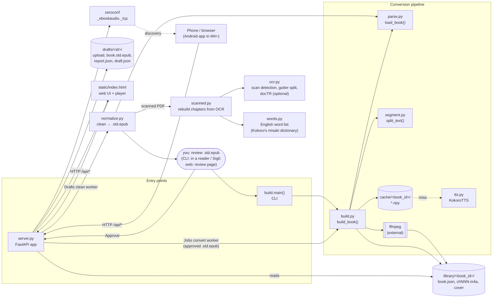

# Desktop component: architecture

The desktop component converts an ebook into a sentence-timestamped audiobook and serves the
library over the LAN. It is a Python package (`desktop/`) with three entry points:

- `python -m desktop.normalize <file> [--ocr auto|always|never]`: cleans any EPUB/PDF/TXT into `<name>.std.epub` plus
  `<name>.std.report.txt` for manual review (D-019). `--ignore-language` skips the English check
- `python -m desktop.build <file.std.epub>`: command-line converter. It only converts cleaned files and
  refuses anything else with the normalize command to run. `--list-chapters` prints numbered chapters, and
  `--ignore-language` skips the English check (D-018).
  `--chapters 3` / `2-4` / `1,3,5-6` converts only those (1-based, after front matter is skipped) into
  `library/<book_id>-ch<spec>/`, a separate folder, so test conversions never touch the full book
- `python -m desktop.server [--port 8000]`: FastAPI server + web UI

## Module diagram



## Modules

| Module | Responsibility | Key API |
|---|---|---|
| `parse.py` | Read EPUB / PDF / TXT (`.md` too) into a uniform `Book` of `Chapter`s. Chapter text is one paragraph per line. Drops chapters under 40 chars. Skips EPUB front matter (cover, title, half title, copyright, contents) using the book's labels, its OPF guide, or exact titles. Removes footnote paragraphs (labelled, or opening with a backlink number, with their small-print continuation lines, D-027) and strips note-reference markers: `<sup>` markers and number-only note links in running text, keeping cross-references such as "Chapters 9 through 11" (D-026). Extracts the cover. | `load_book(path) -> Book`, `clean_body(html)` (shared with `normalize.py`) |
| `segment.py` | Split chapter text into paragraphs of sentences (pysbd). Splits sentences over 350 chars at soft breaks. Attaches punctuation-only fragments to the previous sentence. | `split_text(text) -> list[list[str]]` |
| `normalize.py` | Cleans a book into a standard EPUB: one XHTML file per chapter, with title, author, language, cover and the markers `ebook-audio:normalized` + `ebook-audio:source-sha1`. For EPUB it confirms TOC / contents-page entries against headings in the text and cuts there (with a nested TOC, only its top level and entries that open their own file, D-024; with a flat TOC, only at the chapter heading level, D-025), dropping front matter, contents pages, bibliography, index and endnotes. In every format it removes label-only figure lines. PDF/TXT are repackaged as parsed, and scanned PDFs are rebuilt from OCR (`scanned.py`); the `ocr` mode can force OCR on or off for a PDF (D-030). It writes a report of chapters, removed text, ignored TOC entries and notes (answer placement, words to check). | `normalize(source, out, ignore_language, progress, ocr) -> (path, Report)`, `OCR_MODES` |
| `ocr.py` | Detects scanned PDFs (nearly every page one full-page image), renders pages at 200 dpi, splits two-page scans at the gutter, and runs docTR on each book page. docTR is optional (`requirements-ocr.txt`) and imported only here, so CI and text books never need it; a missing install raises `ValueError` with the install command. Frees the GPU after OCR. | `is_scanned(path)`, `split_spread(img)`, `ocr_pdf(path, progress) -> (pages, cover)`, `make_engine()` (tests replace it) |
| `scanned.py` | Pure functions that turn OCR lines (`Line` of `Word`s with boxes) into chapters: strips running headers, page numbers and the back cover; builds paragraphs from indents, gaps and numbered items; joins drop caps and hyphenated breaks (keeping the hyphen of a compound such as 'good-luck'); fixes clear OCR word errors ('ofthe', 'SO', a quote mark read as '1', D-023); cuts chapters at headings confirmed by the contents page; places quiz answers after each question when the numbering allows (D-022). Returns notes for the report. | `rebuild(pages, lex) -> ScanResult`, `paragraphs(pages, lex, fixes)`, `load_scanned_pdf(path, progress) -> (Book, ScanResult)` |
| `words.py` | A yes/no English word check for the OCR fixes: the pronunciation dictionary shipped with Kokoro's G2P (misaki, ~216,000 entries) plus simple inflections ('berries', 'makes'), possessives and hyphenated compounds. Never suggests a replacement. Empty when misaki is not installed (CI), which turns the dictionary fixes off. | `load_lexicon() -> Lexicon`, `Lexicon.knows(word)` |
| `language.py` | Refuses books whose text isn't in a language the voices speak (English today), judged from the share of English function words in text sampled across the book. Metadata is only a hint. Called by `build_book` before TTS loads. | `check_language(book)`, `english_score(book)` |
| `tts.py` | Wrapper around Kokoro-82M. One model on the GPU with one text pipeline per voice language (a/b) sharing it; `synth` is locked so a voice sample can run between two sentences of a conversion (D-031). One call per sentence, mono float32 at 24 kHz. Uses CUDA when available. | `KokoroTTS(voice, speed).synth(text, voice=None, speed=None)`, `VOICES`, `SAMPLE_RATE` |
| `build.py` | Orchestrates the pipeline: plan, synthesize (cached), stitch with silence gaps, compute timestamps, encode m4a with ffmpeg, write `book.json` after each chapter. | `build_book(source, out_root, voice, speed, progress, tts) -> Path` |
| `server.py` | REST API; drafts on disk with a clean worker (upload → `normalize` → review), a separate single-worker conversion queue for approved books (D-029); static web UI, mDNS advertisement, QR code for the LAN URL. | FastAPI `app`, `Drafts`, `Jobs`, `advertise()` |
| `static/index.html` | Single-page UI with three tabs (D-030): **Clean** (upload with OCR mode, clean or clean & convert, "Cleaning & review" list), **Convert** (upload a cleaned `.std.epub`, approved books, conversion progress), **Library**. Also: review page (check-by-hand list, chapters and their text, removed parts, approve / Sigil download and upload / discard), conversion progress, library grid, reader with sentence highlighting and tap-to-seek. | served at `/` |

## On-disk layout

```
<name>.std.epub            cleaned book next to its source (e.g. samples/), plus <name>.std.report.txt
library/<book_id>/          book_id = <title-slug, max 40 chars>-<sha1(original file)[:8]>;
                            a .std.epub carries the original's sha1, so cleaning or editing keeps the id
    book.json               manifest (below)
    ch000.m4a, ch001.m4a…   AAC 64 kbps mono 24 kHz, +faststart
    cover.<ext>             optional
models/huggingface/         Kokoro-82M (HF_HOME), downloaded on first use (D-028)
models/doctr/               docTR OCR models (DOCTR_CACHE_DIR), downloaded on first use
cache/voice-samples/<voice>-<sha1(text)[:8]>.m4a  ~5 s sample per voice, made on first ▶ click and kept
cache/<book_id>/<sha1>.npy  per-sentence audio, key = sha1("voice|speed|text"); deleted when the book completes
drafts/<id>/                one per book uploaded through the server (D-029); removed by Discard
    <name>.<ext>            the upload, under its own sanitized name (stem capped at 80 chars: Windows path limit)
    book.std.report.txt     the same report as text (written by normalize)
    book.std.epub           the cleaned book (replaced by an uploaded edit)
    report.json             the cleaning Report: method, chapters, removed, unconfirmed, notes, checks
    draft.json              id, file, status, message, done/total, auto, voice, speed, error,
                            chapters, checks, job_id, book_id, source_sha1, created
```

## `book.json` manifest

```json
{
  "id": "my-book-1a2b3c4d",
  "title": "My Book",
  "author": "Someone",
  "cover": "cover.jpg",
  "voice": "af_heart",
  "speed": 1.0,
  "complete": true,
  "chapter_selection": null,
  "created": 1764230400,
  "duration_ms": 123456,
  "chapters": [
    {
      "index": 0,
      "title": "Chapter 1",
      "audio": "ch000.m4a",
      "duration_ms": 61728,
      "sentences": [
        { "i": 0, "p": 0, "text": "It was a dark night.", "start_ms": 300, "end_ms": 1850 }
      ]
    }
  ]
}
```

Invariants:
- `sentences[k].end_ms == sentences[k+1].start_ms`. The pause after a sentence belongs to that
  sentence, so every playback position maps to exactly one sentence.
- Last sentence `end_ms == chapter.duration_ms`. First `start_ms == 300` (chapter lead-in).
- `p` is the paragraph index within the chapter, and `i` is the sentence index within the chapter.
- `chapter_selection` is `null` for a full book, or the `--chapters` spec (e.g. `"2-4"`) for a partial one.
- `complete: false` means the book is still converting (or was interrupted), but the chapters listed so far are playable.

## HTTP API

| Method & path | Purpose |
|---|---|
| `GET /` | Web UI |
| `GET /api/info` | Host name, LAN URL, QR SVG, voice list, default voice |
| `GET /api/books` | Library summary (title, author, cover, chapters, duration, size, complete) |
| `GET /api/books/{id}` | Full `book.json` |
| `GET /api/books/{id}/files/{name}` | Audio/cover file, with HTTP Range support |
| `DELETE /api/books/{id}` | Delete a book folder |
| `POST /api/clean` | Multipart `file`, `voice`, `speed` (0.5–2.0), `auto`, `ocr` (`auto`/`always`/`never`, PDF only) → `{draft_id}`; cleaned, then waits for review (or converts at once with `auto=true`) |
| `POST /api/convert` | Same as `/api/clean` with `auto=true` → `{draft_id}` |
| `POST /api/convert-std` | Multipart `file` (a cleaned `.std.epub`), `voice`, `speed` → `{draft_id, job_id}`; no cleaning, converted at once; 400 for anything without the `ebook-audio:normalized` marker |
| `GET /api/drafts` | All drafts (status, message, OCR progress, chapters, checks, job and book ids) |
| `GET /api/drafts/{id}` | One draft plus its `report` (null until cleaned) |
| `GET /api/drafts/{id}/chapters/{n}` | `{index, title, paragraphs}` of one cleaned chapter |
| `GET /api/drafts/{id}/std.epub` | Download the cleaned book (for Sigil) |
| `POST /api/drafts/{id}/std.epub` | Upload an edited `.std.epub` (multipart `file`); 400 if unreadable |
| `POST /api/drafts/{id}/approve` | Form `voice`, `speed` → `{job_id}`; 409 unless the draft is in review or done |
| `DELETE /api/drafts/{id}` | Discard a draft and its files; 409 while cleaning or converting |
| `GET /api/voices/{voice}/sample` | ~5 s m4a of the voice reading a fixed sentence (made once, then cached); 404 for an unknown voice |
| `GET /api/jobs` | All conversion jobs (queued/running/done/error, progress, `draft_id`) |

Book and draft IDs are validated against `^[a-z0-9\-]{1,80}$` (a draft id must also be a known draft), and file
names reject `/`, `\`, and a leading `.` (path-traversal guard).

## Concurrency model
- Two background daemon threads, each draining its own `queue.Queue`: the clean worker (`Drafts`) and the
  conversion worker (`Jobs`). Cleaning a new book never waits for a conversion; conversions run one at a time
  (one TTS model in memory). docTR is freed after OCR, so both fit on the GPU.
- One `KokoroTTS` is loaded on first use (`Jobs.model()`, its own lock) and kept for every job and voice sample, in
  both voice languages. Only the conversion worker sets its current voice; a sample passes its own.
- Drafts are saved to `draft.json` on every change and reloaded at startup. Jobs live in memory only; a draft whose
  conversion was cut off by a restart goes back to review and resumes from the sentence cache when approved again.

## External dependencies
Python 3.10–3.12, PyTorch (CUDA build recommended), `kokoro`, `ebooklib`, `beautifulsoup4`, `lxml`,
`pymupdf`, `pysbd`, `fastapi`, `uvicorn`, `python-multipart`, `zeroconf`, `qrcode`, and
**ffmpeg on PATH**.

Optional, for scanned PDFs only: `python-doctr` from `requirements-ocr.txt`, which pins torch/torchvision to
the CUDA build so the TTS keeps the GPU (D-021). It is not in `requirements-ci.txt`; the tests use a fake engine.
