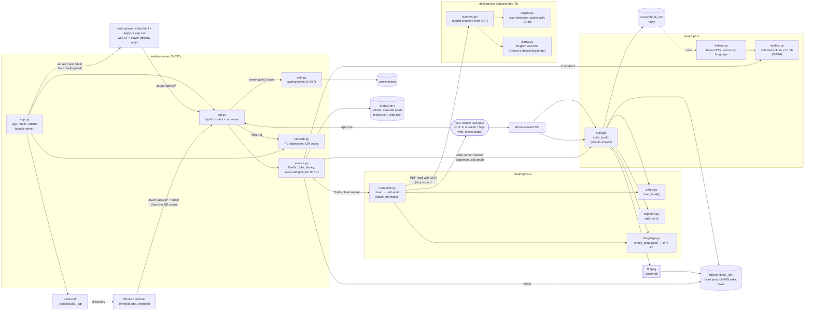

# Desktop component: architecture

The desktop component converts an ebook into a sentence-timestamped audiobook and serves the
library over the LAN. It is a Python package (`desktop/`) split into five parts (D-033), in one project with one
venv:

| Package | Contents | May import |
|---|---|---|
| `desktop/core/` | Book text: parsing, chapter splitting, sentence segmentation, cleaning, language check. No web, GPU or TTS code | nothing else (only `desktop.ocr`, lazily, when `normalize()` reads a PDF) |
| `desktop/ocr/` | Scanned-PDF OCR: detection, page rendering, docTR, rebuilding chapters from OCR lines, word check | `core` |
| `desktop/tts/` | Kokoro speech and the converter that times every sentence and writes the library | `core` |
| `desktop/server/` | Backend service, JSON API v1, the FastAPI app | `core`, `ocr`, `tts` |
| `desktop/web/` | The page: `index.html`, `app.js`, `app.css`, translations `i18n/*.json` (static files, no Python) | `/api/v1` over HTTP only |

Nothing imports `server` or `web`. `desktop/__init__.py` only sets the model cache folders and `PROJECT`.
`tests/test_layers.py` enforces these rules.

Three commands, installed into the venv once with `pip install -e .` (`pyproject.toml`):

- `ebook-normalize <file> [--ocr auto|always|never]` (`desktop.core.normalize:main`): cleans any EPUB/PDF/TXT into
  `<name>.std.epub` plus `<name>.std.report.txt` for manual review (D-019). `--ignore-language` skips the language
  check (English or Chinese, D-042).
- `ebook-convert <file.std.epub>` (`desktop.tts.build:main`): the command-line converter.
  - It only converts cleaned files, and refuses anything else with the `ebook-normalize` command to run.
  - `--list-chapters` prints numbered chapters, and `--ignore-language` skips the language check (D-018); the book is
    then read in the voice's language.
  - A voice that doesn't speak the book's language gives way to that language's default voice (D-043).
  - `--chapters 3` / `2-4` / `1,3,5-6` converts only those chapters (1-based, after front matter is skipped) into
    `library/<book_id>-ch<spec>/`. That is a separate folder, so test conversions never touch the full book.
- `ebook-server [--port 8000]` (`desktop.server.app:main`, also `python -m desktop.server`): one process with three
  layers (D-032):
  - the backend (`server/service.py`);
  - its JSON API under `/api/v1` (`server/api.py`);
  - the web page (`desktop/web/`), which only calls that API.

  Interactive API docs are at `/docs`, and the contract is at `/openapi.json`. `EBOOK_AUDIO_DATA=<folder>` moves
  `library/`, `cache/` and `drafts/` out of the project, for example for a second test server.

## Module diagram



## Modules

| Module | Responsibility | Key API |
|---|---|---|
| `core/parse.py` | Read EPUB / PDF / TXT (`.md` too) into a uniform `Book` of `Chapter`s (D-005). Skips EPUB front matter (D-016), removes footnote paragraphs (D-027) and note-reference markers (D-026), and extracts the cover. | `load_book(path) -> Book`, `clean_body(html)` (shared with `normalize.py`) |
| `core/segment.py` | Split chapter text into paragraphs of sentences: pysbd for English, a rule of its own for Chinese (after 。！？ with their closing quotes, D-042). Splits sentences over 350 chars (Chinese: 120) at soft breaks. Attaches punctuation-only fragments to the previous sentence. | `split_text(text, lang="en") -> list[list[str]]` |
| `core/normalize.py` | Cleans a book into a standard EPUB (D-019): one XHTML file per chapter, with title, author, language, cover and the markers `ebook-audio:normalized` + `ebook-audio:source-sha1`. EPUBs are cut at confirmed headings (D-020, D-024, D-025; flow in `workflow.md` section 0), text PDFs and TXT are repackaged, and scanned PDFs go to `ocr/scanned.py` (imported only when a PDF is read, D-030, D-033). Writes the review report. | `normalize(source, out, ignore_language, progress, ocr) -> (path, Report)`, `OCR_MODES` |
| `ocr/engine.py` | Detects scanned PDFs (nearly every page one full-page image), renders pages at 200 dpi, splits two-page scans at the gutter, and runs docTR on each book page. docTR is optional (`requirements-ocr.txt`) and imported only here, so CI and text books never need it; a missing install raises `ValueError` with the install command. Frees the GPU after OCR. | `is_scanned(path)`, `split_spread(img)`, `ocr_pdf(path, progress) -> (pages, cover)`, `make_engine()` (tests replace it) |
| `ocr/scanned.py` | Pure functions that turn OCR lines (`Line` of `Word`s with boxes) into chapters: page cleanup, paragraphs, word fixes (D-023), chapter cuts and quiz answer placement (D-022). Steps in `workflow.md` section 0b. Returns notes for the report. | `rebuild(pages, lex) -> ScanResult`, `paragraphs(pages, lex, fixes)`, `load_scanned_pdf(path, progress) -> (Book, ScanResult)` |
| `ocr/words.py` | A yes/no English word check for the OCR fixes: the pronunciation dictionary shipped with Kokoro's G2P (misaki, ~216,000 entries) plus simple inflections ('berries', 'makes'), possessives and hyphenated compounds. Never suggests a replacement. Empty when misaki is not installed (CI), which turns the dictionary fixes off. | `load_lexicon() -> Lexicon`, `Lexicon.knows(word)` |
| `core/language.py` | Tells a book's language from its text: Chinese when most letters are Chinese characters, English by the share of English function words (D-018, D-042). Refuses anything else. Metadata is only a hint. Called by `normalize` and by `build_book` before TTS loads. Holds `SUPPORTED_LANGUAGES` (moved from the TTS module, so core imports nothing else, D-033). | `check_language(book) -> "en" \| "zh"`, `detect_language(book)`, `english_score`, `chinese_share`, `SUPPORTED_LANGUAGES` |
| `tts/kokoro.py` | Wrapper around Kokoro-82M. One model on the GPU with one text pipeline per voice language (a/b/z) sharing it; `synth` is locked so a voice sample can run between two sentences of a conversion (D-031). Voices are grouped by language (D-043). Chinese text goes through OpenCC `t2s` for pronunciation, and Latin words in it through an English G2P. With v1.1-zh installed, its voices use a second model, loaded on first use (D-044). One call per sentence, mono float32 at 24 kHz. Uses CUDA when available. | `KokoroTTS(voice, speed).synth(text, voice=None, speed=None)`, `voices(lang)`, `all_voices()`, `default_voice(lang)`, `voice_for(voice, lang)`, `voice_language(voice)`, `SAMPLE_RATE` |
| `tts/models.py` | The optional Kokoro v1.1-zh (D-044): its voice list, whether it is installed, and a background install and remove. No torch import. | `ZhModel`, `zh_installed()`, `repo_of(voice)`, `ZH_VOICES` |
| `tts/build.py` | Orchestrates the pipeline: plan, synthesize (cached), stitch with silence gaps, compute timestamps, encode m4a with ffmpeg, write `book.json` after each chapter. `ROOT` is the data folder (`EBOOK_AUDIO_DATA` or the project). Stops with `Cancelled` between sentences when its `cancel` event is set (D-038). | `build_book(source, out_root, voice, speed, progress, tts, chapters, merge, cancel) -> Path`, `Cancelled`, `encode_m4a`, `ROOT`, `main()` |
| `server/service.py` | The backend, with no HTTP in it (D-032): drafts on disk with a clean worker (upload → `normalize` → review), a separate single-worker conversion queue for approved books (D-029), the library (list, manifest, file, delete) and cached voice samples. Every input check lives here, and refusals raise `Invalid` (400), `NotFound` (404) or `Conflict` (409). | `Drafts`, `Jobs`, `drafts`, `jobs`, `list_books()`, `read_book()`, `book_file()`, `delete_book()`, `voice_sample()`, `ServiceError` |
| `server/api.py` | The JSON API v1 (`APIRouter(prefix="/api/v1")`): thin routes that call `service.py` and return Pydantic models, which are the written contract for the web page and the Android app. Uploads are multipart and every other body is JSON. Every error is `{"detail": ...}`. Every route depends on `auth.require_pairing` (D-037). | `router`, `API_VERSION`, models `Draft`, `DraftDetail`, `Job`, `BookSummary`, `Book`, `Info`, `Address`, `ApproveRequest`, `Error` |
| `server/auth.py` | The pairing token (D-037), kept in `<data>/server-token`. Lets a request through from the PC's own page or with the token (`Authorization: Bearer` or `?token=`); otherwise 401. The exact local-page rule is in D-037; the flow in `workflow.md` 4b. | `token(new=False)`, `require_pairing(request)`, `is_local(request)` |
| `server/network.py` | The PC's addresses for the phone (D-037), with no HTTP. It lists IPv4 addresses with adapter names (`ifaddr`, no loopback or link-local) and picks the default (`--advertise`, else `EBOOK_AUDIO_ADVERTISE`, else the default-route address). It also checks a typed address and builds the `#token=` URL and its QR SVG. | `phone_addresses(override)`, `preferred_address()`, `parse_address(text, port)`, `pair_url()`, `qr_svg()` |
| `server/app.py` | The FastAPI `app`: includes the router, maps `ServiceError` to its status, serves `/` and `/static` (from `desktop/web/`), advertises mDNS on every IPv4 address (`path=/api/v1`) and prints the page and docs URLs at startup (no phone addresses: a phone scans the QR code on the page, which holds the token). Options: `--port`, `--advertise <address>`, `--new-token`. No domain logic. | `app`, `advertise()`, `main()` |
| `web/` | `index.html` (markup), `app.css`, `app.js`: plain files with no build step. They display data and call only `/api/v1`; they don't clean or convert anything (checked by `test_api03`). Single-page UI with three tabs (D-030): **Clean** (upload with OCR mode, clean or clean & convert, "Cleaning & review" list), **Convert** (upload a cleaned `.std.epub`, approved books, conversion progress), **Library**. Also: review page (check-by-hand list, chapters and their text with a checkbox each to choose what to convert, removed parts, approve / Sigil download and upload / discard), conversion progress, library grid, reader with sentence highlighting and tap-to-seek, previous/next sentence buttons and a text size control kept in `localStorage` (D-039). Home: the QR code, a button for each PC address to switch it, and a field for a typed address (D-037). A token from `#token=` is kept and sent with every API call. Draft and job cards have **Cancel**, and draft cards show "converted N of M" (D-038). Every voice choice is a **Language ▸ Voice** pair (D-043), and a "Better Chinese voices" box installs or removes Kokoro v1.1-zh (D-044). Text in English, Simplified or Traditional Chinese from `i18n/en.json`, `zh-Hans.json`, `zh-Hant.json`: `data-i18n*` attributes in the markup, `t(key, vars)` in the script; the language follows the browser or the **EN / 简体 / 繁體** buttons (`localStorage` `ebookAudioLang`, D-040). Server messages stay English. | served at `/`; `i18n/` at `/static/i18n/` |

## On-disk layout

Data folders sit in the project, or under `EBOOK_AUDIO_DATA` (`library/`, `cache/`, `drafts/`). Model caches always
sit in the project.

```
<name>.std.epub            cleaned book next to its source (e.g. samples/), plus <name>.std.report.txt
library/<book_id>/          book_id = <title-slug, max 40 chars>-<sha1(original file)[:8]>;
                            a .std.epub carries the original's sha1, so cleaning or editing keeps the id
    book.json               manifest (below)
    ch000.m4a, ch001.m4a…   AAC 64 kbps mono 24 kHz, +faststart
    cover.<ext>             optional
server-token                the pairing token (D-037); gitignored. Delete it, or start with --new-token, to unpair
                            every phone
models/huggingface/         Kokoro-82M (HF_HOME), downloaded on first use (D-028); Kokoro-82M-v1.1-zh when installed (D-044)
models/jieba/               jieba's Chinese dictionary cache, made on the first Chinese sentence (D-043)
models/doctr/               docTR OCR models (DOCTR_CACHE_DIR), downloaded on first use
cache/voice-samples/<voice>-<sha1(text)[:8]>.m4a  ~5 s sample per voice, made on first ▶ click and kept
cache/<book_id>/<sha1>.npy  per-sentence audio, key = sha1("voice|speed|text"); after a run, the converted chapters'
                            entries are deleted, and the whole folder once the book is complete (D-035)
drafts/<id>/                one per book uploaded through the server (D-029); removed by Discard
    <name>.<ext>            the upload, under its own sanitized name (stem capped at 80 chars: Windows path limit)
    book.std.report.txt     the same report as text (written by normalize)
    book.std.epub           the cleaned book (replaced by an uploaded edit)
    report.json             the cleaning Report: method, language, chapters, removed, unconfirmed, notes, checks
    draft.json              id, file, status, message, done/total, auto, voice, speed, error,
                            chapters, checks, job_id, book_id (set at approval), source_sha1, created,
                            last_chapters (the last approval's selection; null = all)
```

## `book.json` manifest

```json
{
  "id": "my-book-1a2b3c4d",
  "title": "My Book",
  "author": "Someone",
  "language": "en",
  "cover": "cover.jpg",
  "voice": "af_heart",
  "speed": 1.0,
  "complete": true,
  "chapter_selection": null,
  "chapters_total": 12,
  "created": 1764230400,
  "duration_ms": 123456,
  "chapters": [
    {
      "index": 0,
      "number": 1,
      "title": "Chapter 1",
      "audio": "ch000.m4a",
      "duration_ms": 61728,
      "size_bytes": 495310,
      "updated_ms": 1795824078987,
      "voice": "af_heart",
      "speed": 1.0,
      "text_sha1": "5f1e…",
      "sentences": [
        { "i": 0, "p": 0, "text": "It was a dark night.", "start_ms": 300, "end_ms": 1850 }
      ]
    }
  ]
}
```

Invariants:
- `sentences[k].end_ms == sentences[k+1].start_ms`. The pause after a sentence belongs to that
  sentence, so every playback position maps to exactly one sentence.
- Last sentence `end_ms == chapter.duration_ms`. First `start_ms == 300` (chapter lead-in).
- `p` is the paragraph index within the chapter, and `i` is the sentence index within the chapter.
- Chapters are sorted by `number`, their 1-based number in the cleaned book. `index` is the position in this list.
  `audio` is `ch{number-1:03d}.m4a`, so the name doesn't change as more chapters are added (D-035).
- Each chapter has its own `voice`, `speed` and `text_sha1` (`build.chapter_text_sha1` of the chapter text, to spot a
  chapter edited after it was converted). The book-level `voice`/`speed` are those of the latest run.
- `chapters_total` is how many chapters with text the folder should hold: the whole cleaned book, or the selection
  for a CLI `-ch<spec>` test folder. `complete` is true when all of them are converted. The chapters listed so far are
  playable either way. "Converting" is not in the file; `GET /books` reports it from the job queue.
- `size_bytes` and `updated_ms` (the `.m4a`'s size, and its mtime in epoch ms) are the chapter's version. A
  re-converted chapter keeps its file name, so a phone compares these with its copy (D-038). `GET /books/{id}` fills
  them in from the file for books written before D-038.
- `language` is `en` or `zh`, the detected language the book was read in (D-042). Books before it have none and are
  English. Chinese sentences are shown with no space between them.
- `chapter_selection` is `null` except in a CLI `--chapters` test folder, where it holds the spec (e.g. `"2-4"`).
- Books written before D-035 have no `number`, `voice`/`speed` per chapter, `text_sha1` or `chapters_total`.
  `build.chapter_number()` takes the number from the audio name for a full book (exact even when an empty chapter
  was skipped). For an old test folder it takes the number from `chapter_selection` when the spec selects as many
  chapters as the folder holds, otherwise from the position. A chapter with no hash counts as converted.

## HTTP API v1 (D-032)

The routes, error format, pairing rules and which calls the Android app makes are in [api.md](api.md).

## Concurrency model
- Two background daemon threads, each draining its own `queue.Queue`: the clean worker (`Drafts`) and the
  conversion worker (`Jobs`). Cleaning a new book never waits for a conversion; conversions run one at a time
  (one TTS model in memory). docTR is freed after OCR, so both fit on the GPU.
- One `KokoroTTS` is loaded on first use (`Jobs.model()`, its own lock) and kept for every job and voice sample, in
  every voice language. With Kokoro v1.1-zh installed, its model joins on the first sentence of one of its voices and
  leaves when it is removed (D-044). Only the conversion worker sets its current voice; a sample passes its own.
- Ctrl+C (D-036): both workers are daemon threads and stop with the process, and every file is written to a temp
  name and renamed (`*.npy.tmp`, `*.tmp.m4a`, `book.tmp`, `draft.tmp`). What an interruption leaves behind is in `workflow.md` 4a. This assumes one server per data
  folder (a second server needs its own `EBOOK_AUDIO_DATA`).
- Cancel (D-038): each job holds a `threading.Event`.
  - For a queued job, `Jobs.cancel` sets the status to `cancelled` under the jobs lock. The worker checks the status
    under the same lock before starting a job.
  - For a running job, it sets the event, and `build_book` raises `Cancelled` at the next sentence.
  - The model stays loaded.
- Drafts are saved to `draft.json` on every change and reloaded at startup. Jobs live in memory only; a draft whose
  conversion was cut off by a restart goes back to review and resumes from the sentence cache when approved again.

## External dependencies
Python 3.10–3.12, PyTorch (CUDA build recommended), `kokoro`, `misaki[zh]` (jieba, pypinyin, cn2an: Chinese
G2P) and `opencc-python-reimplemented` (Traditional → Simplified for pronunciation, D-043), `ebooklib`, `beautifulsoup4`, `lxml`,
`pymupdf`, `pysbd`, `fastapi`, `uvicorn`, `python-multipart`, `zeroconf`, `qrcode`, `ifaddr` (the PC's addresses), and
**ffmpeg on PATH**.

Optional, for scanned PDFs only: `python-doctr` from `requirements-ocr.txt`, which pins torch/torchvision to
the CUDA build so the TTS keeps the GPU (D-021). It is not in `requirements-ci.txt`; the tests use a fake engine.
