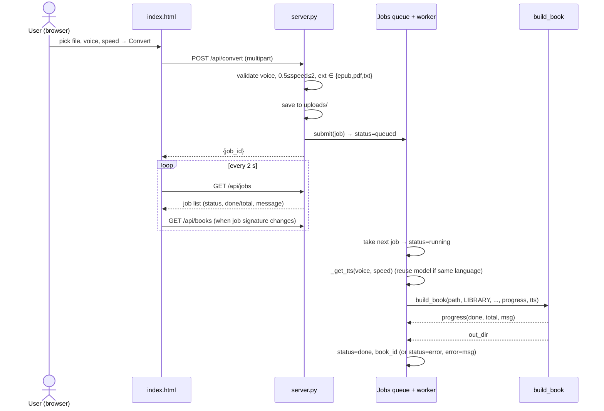
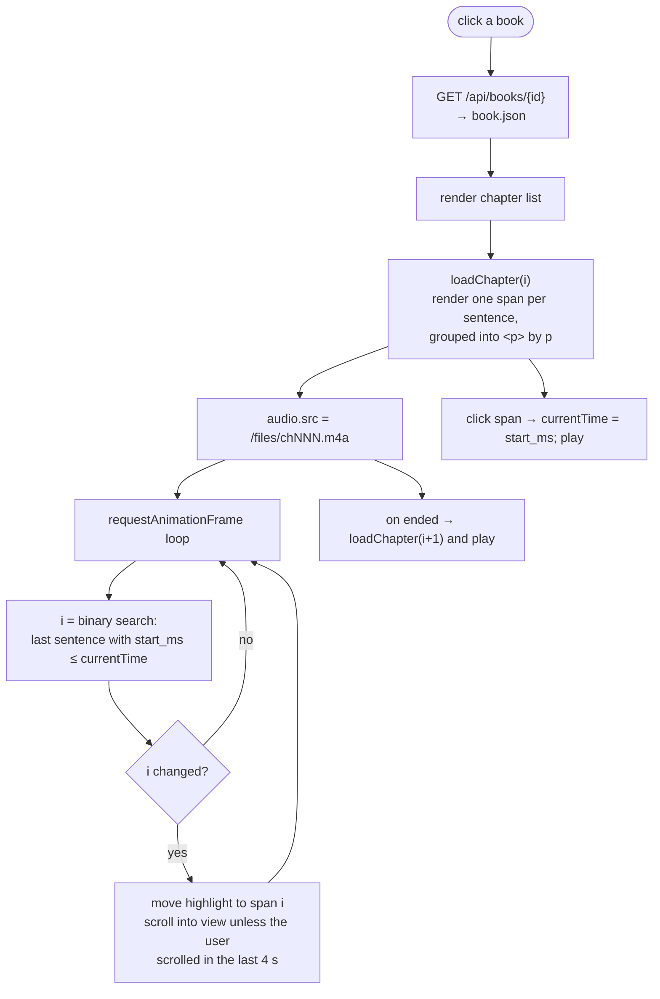
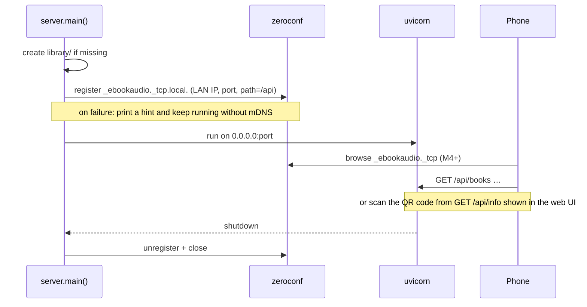

# Desktop component: workflows

## 1. Convert a book (`build_book`)

Used by both the CLI and the server worker.

### 1a. Stitching a chapter (`assemble_chapter`)

### 1b. Resume after interruption
If the process dies mid-book, the next run of the same file (same `book_id`) re-plans everything.
Sentences already in `cache/<book_id>/` load from disk instead of running TTS again, so only the
missing sentences cost GPU time. The m4a files and `book.json` are rewritten from scratch.

## 2. Convert through the server

## 3. Listen with sentence sync (web player)

## 4. Server startup and discovery

