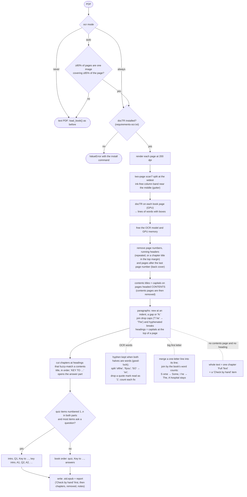
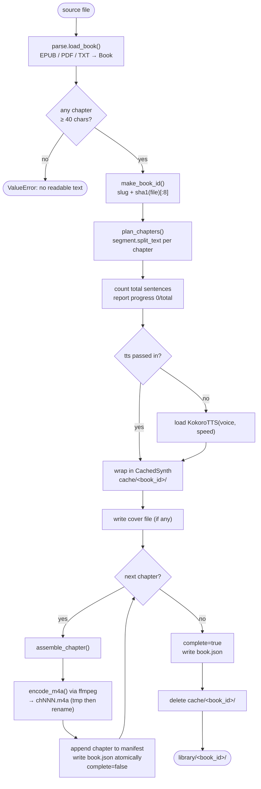
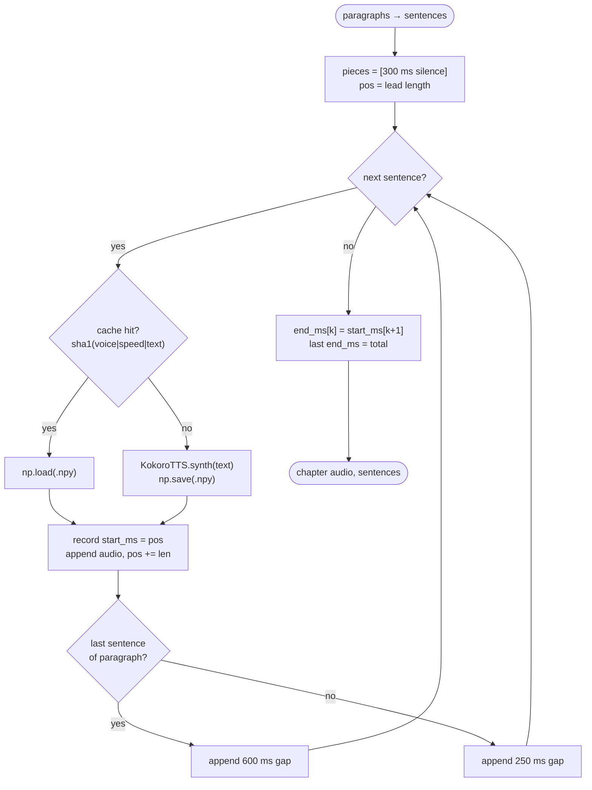
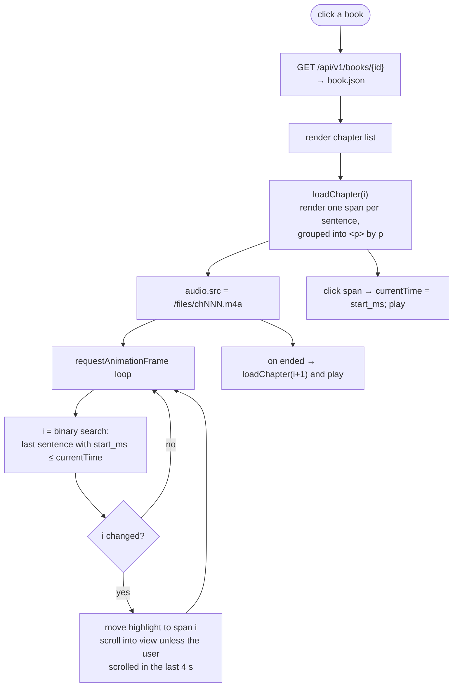
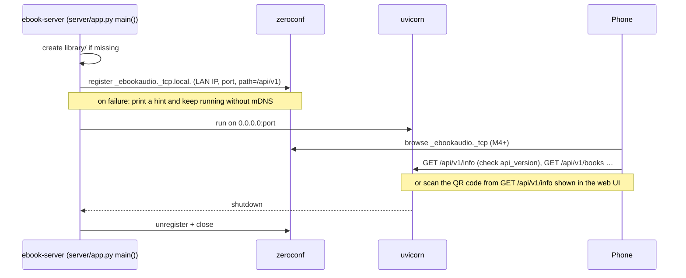

# Desktop component: workflows

## 0. Clean a book, review it, then convert (`ebook-normalize` = `desktop/core/normalize.py`, D-019/D-020)

The CLI only converts cleaned files (`.std.epub`). The web UI cleans too and stops for review (section 2, D-029).
EPUBs are cut at confirmed headings, scanned PDFs are rebuilt from OCR (0b), and text PDFs and TXT are repackaged.

```mermaid
flowchart TD
    A([book.epub / .pdf / .txt]) --> SC{"PDF read with OCR?<br/>ocr=always: yes · never: no<br/>auto: when it is a scan (D-030)"}
    SC -- yes --> OCR["OCR rebuild (section 0b)"] --> LANG
    SC -- no --> L["load_book() for metadata, cover,<br/>labelled front matter;<br/>footnote paragraphs removed (D-027), then note markers<br/>stripped (sup, number-only note links, D-026)"]
    L --> LANG{English?}
    LANG -- no --> X([refused: error names metadata language<br/>--ignore-language to override])
    LANG -- yes --> F{format}
    F -- "text PDF / TXT" --> P["repackage parsed chapters"]
    F -- "scanned PDF" --> W
    F -- EPUB --> B["flatten spine into text blocks<br/>map every id anchor to a block<br/>mark contents pages (≥5 short all-link paragraphs)"]
    B --> C["candidates = navigation TOC + contents-page links<br/>nested TOC: top level only, plus nested entries that open<br/>their own file; no contents-page links (D-024)<br/>drop N.M subsections when chapter N exists"]
    C --> D{"plausible title?<br/>≤120 chars, ≥3 letters, capital first,<br/>no glued footnote number"}
    D -- no --> IGN["ignored (in report)"]
    D -- yes --> E{"whole-file entry<br/>(no #anchor)?"}
    E -- yes --> CUT["cut at the file start"]
    E -- no --> H["search for a heading equal to the title,<br/>starting at the anchor: a block's opening element,<br/>or its first lines joined (split headings);<br/>a leading label is ignored: '1 X' = 'CHAPTER ONE' + 'X'"]
    H -- found --> CUT
    H -- "not found" --> IGN
    CUT --> G{"any cut?"}
    G -- no --> FB["fallback: one chapter per file"]
    G -- yes --> LV["chapter level = heading level of the cuts with real text<br/>(file-opening cuts; single file: highest level with 3+)"]
    LV --> HF["also cut at every file that opens<br/>with &lt;h1&gt;-&lt;h3&gt; at or above the chapter level<br/>(missing from the TOC), except files the TOC labels front matter"]
    HF --> SEC["flat TOC: mid-file cuts below the chapter level<br/>(or on no heading, when most cuts are headings)<br/>stay inside the chapter before them (D-025)"]
    SEC --> R["text before first cut, contents pages,<br/>front-matter titles, Bibliography / References / Index / Notes / Endnotes,<br/>label-only figure lines ('FIGURE' + '1.1')<br/>→ removed (in report)<br/>short part headings → read with next chapter"]
    R --> W
    P --> W
    FB --> W["write &lt;name&gt;.std.epub (one file per chapter)<br/>+ &lt;name&gt;.std.report.txt"]
    W -.- KEEP["input already .std.epub, no --out:<br/>report only, nothing written"]
    W --> REV(["you: open in a reader, check chapters,<br/>fix in Sigil if needed"])
    REV --> BUILD(["ebook-convert &lt;name&gt;.std.epub"])
```



Before `load_book`, a PDF whose pages are nearly all one full-page image is treated as a scan
and read with OCR (section 0b). The language check then runs on the OCR text.

## 0b. Scanned PDF: OCR and rebuild (`desktop/ocr/engine.py`, `desktop/ocr/scanned.py`, D-021/D-022)

`normalize()` (core) imports these only when a PDF is read with OCR (D-033), so cleaning EPUB and TXT never loads
the OCR package.



## 1. Convert a book (`build_book`)

Used by both the CLI and the server worker.



### 1a. Stitching a chapter (`assemble_chapter`)



### 1b. Resume after interruption
If the process dies mid-book, the next run of the same file (same `book_id`) re-plans everything.
Sentences already in `cache/<book_id>/` load from disk instead of running TTS again, so only the
missing sentences cost GPU time. The m4a files and `book.json` are rewritten from scratch.

## 2. Clean, review and convert through the server (D-029)

### 2a. Draft states

```mermaid
stateDiagram-v2
    [*] --> cleaning: POST /api/v1/drafts (file, voice, speed, auto, ocr) · Clean page
    [*] --> queued: POST /api/v1/drafts/cleaned (a cleaned .std.epub) · Convert page
    cleaning --> error: normalize() fails (language, no text, OCR not installed)
    cleaning --> review: .std.epub + report.json written
    review --> queued: Approve & convert (or auto=true right away)
    review --> review: upload edited .std.epub (rewritten with the original sha1)
    queued --> converting: Jobs worker takes it
    converting --> done: book in library/
    converting --> review: conversion failed (error shown)
    done --> queued: convert again (another voice)
    review --> [*]: Discard
    done --> [*]: Discard
    error --> [*]: Discard
    note right of cleaning: server restart: cleaning becomes error,<br/>queued/converting go back to review
```

### 2b. Sequence

```mermaid
sequenceDiagram
    actor U as User (browser or Android app)
    participant UI as desktop/web/app.js (or the app)
    participant API as server/api.py (/api/v1)
    participant C as service.Drafts: queue + clean worker
    participant Q as service.Jobs: queue + convert worker
    participant B as build_book

    U->>UI: pick file, voice, speed, (skip review?) → Clean
    UI->>API: POST /api/v1/drafts (multipart)
    API->>C: Drafts.create(): validate voice, 0.5≤speed≤2, ocr, ext ∈ {epub,pdf,txt}
    C->>C: drafts/<id>/ with the upload + draft.json, status=cleaning
    API-->>UI: {draft_id} (a refusal: 400 {"detail": "..."})
    loop every 2 s
        UI->>API: GET /api/v1/drafts, GET /api/v1/jobs (the app may poll GET /jobs/{id})
        UI->>API: GET /api/v1/books (when the job signature changes)
    end
    C->>C: normalize(upload, drafts/<id>/book.std.epub, progress)
    C-->>UI: message "Reading scanned pages n/N" (OCR)
    C->>C: report.json, status=review (auto: approve at once)
    U->>UI: Review
    UI->>API: GET /api/v1/drafts/{id} (report), GET …/chapters/{n} (one chapter's text)
    opt fix in Sigil
        U->>API: GET …/std.epub, edit, PUT …/std.epub
    end
    U->>UI: Approve & convert (voice, speed)
    UI->>API: POST /api/v1/drafts/{id}/approve, JSON {"voice", "speed"} (both optional)
    API->>Q: submit(book.std.epub, draft_id) → draft status=queued; → {job_id}
    Q->>Q: draft status=converting; one shared model (D-031)
    Q->>B: build_book(std, LIBRARY, ..., progress, tts)
    B-->>Q: progress(done, total, msg) / out_dir
    Q->>Q: job done, draft status=done + book_id (on error: draft back to review)
```

There is no separate one-step convert route: `POST /api/v1/drafts` with `auto=true` cleans and converts with no review
stop (D-032).

## 3. Listen with sentence sync (web player)



## 4. Server startup and discovery


